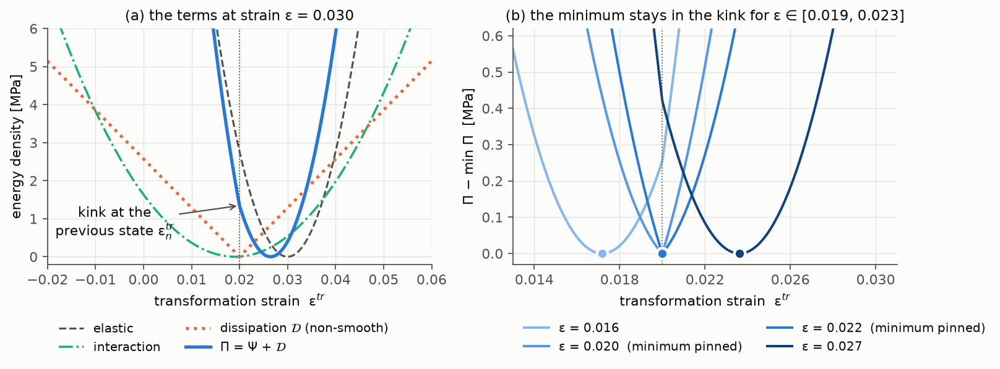

# The minimization program

One constitutive step is one small optimization problem. This page writes it out for the one-dimensional
(uniaxial) model. The same formulas are implemented in [code/energy_1d.py](code/energy_1d.py).

## Known and unknown quantities

| | Symbol | Meaning |
|---|---|---|
| Load at the end of the step | $\varepsilon$, $T$ | strain, temperature |
| State at the start of the step | $\xi_n$, $\varepsilon^{\mathrm{tr}}_n$, $M_n$ | martensite fraction, transformation strain, memory variable |
| **Unknowns** | $\xi$, $\varepsilon^{\mathrm{tr}}$ | the same two internal variables at the end of the step |

The increments are $\Delta\xi = \xi - \xi_n$ and $\Delta\varepsilon^{\mathrm{tr}} = \varepsilon^{\mathrm{tr}} - \varepsilon^{\mathrm{tr}}_n$.

## The program

```math
(\xi,\ \varepsilon^{\mathrm{tr}}) \;=\; \arg\min_{\xi,\ \varepsilon^{\mathrm{tr}}}\ \Pi
\qquad\text{with}\qquad
\Pi \;=\; \Psi(\varepsilon, T, \xi, \varepsilon^{\mathrm{tr}}) \;+\; \mathcal{D}(\xi, \varepsilon^{\mathrm{tr}};\ \xi_n, \varepsilon^{\mathrm{tr}}_n, M_n)
```

subject to

```math
0 \le \xi \le 1, \qquad -\varepsilon^{\mathrm{tr}}_{\max}/c \;\le\; \varepsilon^{\mathrm{tr}} \;\le\; \varepsilon^{\mathrm{tr}}_{\max}.
```

$\Psi$ is the free energy and $\mathcal{D}$ the energy dissipated by the change. The limit in compression is
smaller than in tension by the factor $c = 1/\cos\!\big(\tfrac13\arccos(1 - 2\cdot 0.9)\big) \approx 1.49$.

### Free energy

```math
\Psi \;=\;
\underbrace{\tfrac12\,E(\xi)\,\big(\varepsilon - \xi\varepsilon^{\mathrm{tr}}\big)^2}_{\text{elastic}}
\;+\; \underbrace{(T - T_0)\,\Delta S\,\xi}_{\text{chemical}}
\;+\; \underbrace{\xi\,\varphi(\varepsilon^{\mathrm{tr}}, \varepsilon)}_{\text{interaction}}
```

```math
\frac{1}{E(\xi)} = \frac{1-\xi}{E_A} + \frac{\xi}{E_M},
\qquad
\varphi(\varepsilon^{\mathrm{tr}}, \varepsilon) =
\frac{E_{\mathrm{int}}}{2\,\varepsilon^{\mathrm{tr}}_{\max}}\,\big(c_\pm\,\varepsilon^{\mathrm{tr}}\big)^2
+ \frac{3\,E_{\mathrm{incl}}}{2\,\varepsilon^{\mathrm{tr}}_{\max}}\,\Big(\varepsilon^{\mathrm{tr}} - \tfrac23\varepsilon\Big)^2 ,
```

with $c_\pm = 1$ in tension and $c_\pm = c$ in compression. The elastic term couples the two unknowns through
their product. The chemical term makes martensite cheaper at low temperature. The interaction term adds
hardening during reorientation and the energy of martensite inclusions.

### Dissipation

The dissipation has two branches, because forming martensite and removing it are different processes. With
$\tau_0 = \sigma_{\mathrm{reo}}\sqrt{3/2}$:

**Forward transformation**, $\Delta\xi \ge 0$:

```math
\mathcal{D} = \tau_0\,\big|\xi\varepsilon^{\mathrm{tr}} - \xi_n\varepsilon^{\mathrm{tr}}_n\big|
\;+\; \Delta S\,\Big[(T_0 - M_s)\,\Delta\xi + \tfrac12\,(M_s - M_f)\,\big(\xi^2 - \xi_n^2\big)\Big]
```

**Reverse transformation**, $\Delta\xi < 0$:

```math
\mathcal{D} = \tau_0\,\xi\,\big|\varepsilon^{\mathrm{tr}} - \varepsilon^{\mathrm{tr}}_n\big|
\;+\; \sigma_{\mathrm{reo}}\,M_n\,|\Delta\xi|
\;+\; \Delta S\,\Big[(A_f - T_0)\,|\Delta\xi| + \tfrac12\,(A_s - A_f)\,\big(\xi_n^2 - \xi^2\big)\Big]
```

In the forward branch the new martensite forms already oriented, so the reorientation cost acts on the change of
the product $\xi\varepsilon^{\mathrm{tr}}$. In the reverse branch the remaining martensite reorients and the
vanishing part pays $\sigma_{\mathrm{reo}} M_n$. The factor $\sqrt{3/2}$ is the norm of the uniaxial
transformation-strain tensor $\varepsilon^{\mathrm{tr}}\,[1, -\tfrac12, -\tfrac12, 0, 0, 0]$.

### Memory variable and stress

After the minimization,

```math
M_{n+1} = \max\!\Big(M_n \cdot \min\!\big(\tfrac{\xi_n}{\xi},\,1\big),\ \sqrt{3/2}\,\big|\varepsilon^{\mathrm{tr}}\big|\Big),
\qquad
\sigma = E(\xi)\,\big(\varepsilon - \xi\varepsilon^{\mathrm{tr}}\big).
```

$M$ is bounded by $\sqrt{3/2}\,\varepsilon^{\mathrm{tr}}_{\max} \approx 0.086$. Dropping the inner $\min$ lets $M$
grow without bound during reverse transformation; that was a real bug in an early surrogate (step 01).

## Where the difficulty is

**The objective has kinks.** Every absolute value above is a kink, and the two branches meet with different
slopes at $\Delta\xi = 0$. At the old state the one-sided slopes of $\Pi$ differ by

- $2\,\tau_0\,\xi_n$ in the direction of $\varepsilon^{\mathrm{tr}}$, and
- $\tau_0\,|\varepsilon^{\mathrm{tr}}_n| + \sigma_{\mathrm{reo}} M_n + \Delta S\,(A_f - M_s)$ in the direction of $\xi$
  (the last term is 6 MPa in this calibration).

**The minimum sits in the kink for a whole range of loads.** While the driving forces stay inside these bands,
the minimizer is exactly the old state. The figure shows it for fully martensitic material at $-80\,^\circ$C:



*Shown: the energy $\Pi$ along the unknown $\varepsilon^{\mathrm{tr}}$ for fully martensitic material ($\xi = 1$) at $-80\,^\circ$C, with the old state $\varepsilon^{\mathrm{tr}}_n = 0.020$. (a) The terms of $\Pi$ at strain $\varepsilon = 0.030$. (b) $\Pi$ for four strains; each dot is the lowest point of its curve, which is the solution for that strain. Computed with [code/energy_1d.py](code/energy_1d.py), using the modulus (55.3 GPa) and reorientation stress (105 MPa) of this temperature.*

Panel (a): the elastic and interaction terms are smooth; the dissipation adds the kink. The blue curve is the sum
of the other three. Each curve is shifted vertically so that its own lowest point is at zero, which is why the
plotted values do not add up point by point. Panel (b): for every
strain between 0.019 and 0.023 the minimum stays at $\varepsilon^{\mathrm{tr}}_n = 0.020$. Only outside this
interval does the state move. A solver has to return *exactly* the old state there, and a method that only
approaches the minimum never does.

**Convexity depends on the variables.** In $(\xi,\ q)$ with $q = \xi\varepsilon^{\mathrm{tr}}$ the program above
is strictly convex and has one minimum. In the solver's variables $(\xi,\ \varepsilon^{\mathrm{tr}})$ it is not
convex. The reference implementation departs from this in two places: it linearizes the stiffness within a
step and averages the memory variable.

## Calibration

| Parameter | Value | Meaning |
|---|---|---|
| $\varepsilon^{\mathrm{tr}}_{\max}$ | 0.07 | largest transformation strain in tension |
| $\Delta S$ | 0.40 MPa/K | entropy difference between the phases |
| $T_0 = M_s$, $M_f$ | $-30$, $-60\ ^\circ$C | start and finish of the forward transformation |
| $A_s$, $A_f$ | $-45$, $-15\ ^\circ$C | start and finish of the reverse transformation |
| $\sigma_{\mathrm{reo}}$ | 100 MPa | reorientation stress at $T_0$ |
| $E_A$ | 71 GPa | Young's modulus of austenite |
| $E_M$ | 46 GPa (tension), 107 GPa (compression) | Young's modulus of martensite |
| $E_{\mathrm{int}}$, $E_{\mathrm{incl}}$ | 30, 200 MPa | interaction energies |

## The map a surrogate has to reproduce

Every learned model in the later steps has the same interface as the solver step:

```math
\big[\xi_n,\ \varepsilon^{\mathrm{tr}}_n,\ M_n,\ \varepsilon,\ T\big] \;\longmapsto\; \big[\xi,\ \varepsilon^{\mathrm{tr}}\big],
```

applied step after step, with its own output as the next input.
