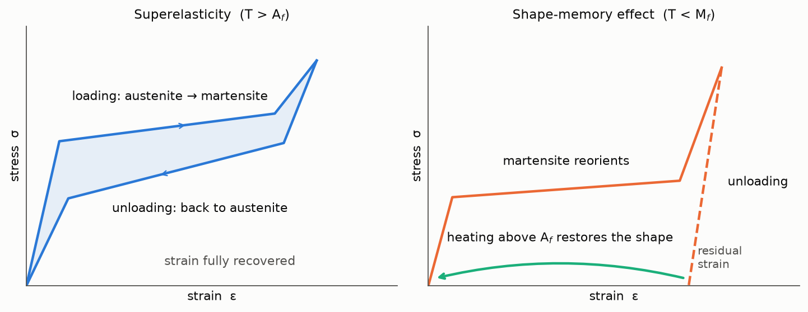

# Physical background

This page explains the material and the modelling framework for a reader who is not a materials scientist. The
mathematics of one solver step is in [minimization-program.md](minimization-program.md).

## Shape-memory alloys

Nitinol (NiTi) is a metal that exists in two crystal structures:

- **austenite**, stable at high temperature, with a cubic lattice;
- **martensite**, stable at low temperature or under stress, with a lower symmetry. Martensite forms in several
  *variants* (orientations of the same lattice).

The change between them is a *martensitic transformation*: the atoms shift together, without diffusion, and the
change is reversible. Two effects follow from it.



*Shown: schematic stress–strain curves of the two regimes, loading and unloading. Computed: nothing; the curves are drawn by hand to show the shapes.*

**Superelasticity** (temperature above $A_f$). Loading turns austenite into martensite, which gives a long stress
plateau. Unloading turns it back, and a strain of 6–8 % is fully recovered. That is about ten times the elastic strain of ordinary metals.
The loading and unloading plateaus differ, so the stress–strain curve is a closed hysteresis loop.

**Shape-memory effect** (temperature below $M_f$). The material is already martensite. Loading reorients its
variants in the direction of the load. The strain stays after unloading, and heating above $A_f$ removes it.

Four temperatures describe the transformation without stress: martensite starts to form at $M_s$ and finishes at
$M_f$ on cooling; austenite starts at $A_s$ and finishes at $A_f$ on heating. Stress shifts all of them, by about
5.7 MPa per kelvin in this calibration.

The applications (stents, orthodontic wires, actuators, seismic dampers) are designed with finite-element
simulations, and those need a model of the material.

## Internal variables

The model describes the microstructure at a material point by a few numbers that are not measured directly:

| Symbol | Meaning | Range |
|---|---|---|
| $\xi$ | volume fraction of martensite | 0 (austenite) to 1 (martensite) |
| $\varepsilon^{\mathrm{tr}}$ | transformation strain of the martensite: how strongly its variants are oriented | $-0.047$ to $0.07$ |
| $M$ | memory variable: the largest transformation-strain norm reached, reduced when martensite disappears | 0 to 0.086 |

The macroscopic transformation strain is the product $q = \xi\,\varepsilon^{\mathrm{tr}}$. It is the part of the
total strain $\varepsilon$ that is not elastic, so the stress is

```math
\sigma = E(\xi)\,\big(\varepsilon - \xi\,\varepsilon^{\mathrm{tr}}\big).
```

The observable inputs are the strain $\varepsilon$ and the temperature $T$. The response depends on the history
through $(\xi, \varepsilon^{\mathrm{tr}}, M)$: the same strain and temperature give different stresses on loading
and on unloading.

## Generalized standard materials

The model is written in the framework of *generalized standard materials* (Halphen and Nguyen, 1975). Two scalar
functions define it completely:

- the **free energy** $\Psi(\varepsilon, T, \xi, \varepsilon^{\mathrm{tr}})$: the stored elastic, chemical and
  interaction energy;
- the **dissipation potential** $\mathcal{D}$: the energy lost as heat when the internal variables change.

The internal variables are driven by the forces $X_\xi = -\partial\Psi/\partial\xi$ and
$X_{\varepsilon^{\mathrm{tr}}} = -\partial\Psi/\partial\varepsilon^{\mathrm{tr}}$, and the dissipation potential says how
fast they respond:

```math
\big(X_\xi,\ X_{\varepsilon^{\mathrm{tr}}}\big) \in \partial\mathcal{D}\big(\dot\xi,\ \dot\varepsilon^{\mathrm{tr}}\big).
```

Here $\partial\mathcal{D}$ is the subdifferential, the generalization of the derivative to functions with kinks.
Models of this form satisfy the second law of thermodynamics by construction.

The transformation in NiTi barely depends on the loading rate. A rate-independent $\mathcal{D}$ is positively
homogeneous of degree one: doubling the rates doubles the dissipation. Such a function has a **kink at zero**,
like the absolute value. That kink has two consequences that run through this whole repository:

1. **Thresholds.** The internal variables do not move until the driving force exceeds a finite threshold. Below
   it the material responds elastically. This is the source of the hysteresis.
2. **A non-smooth optimization problem.** In a time step, the new state minimizes the stored energy plus the
   energy dissipated on the way from the old state (next page). The objective has a kink exactly at the old state.

Readers from other fields may know the same structure under other names. A convex energy plus a degree-one
penalty on the *change* of the variables is the form of an optimization with proportional transaction costs, and
of the L1-regularized problems in signal processing. In all of them the solution has a "do nothing" region around
the previous state, and the natural solver is a proximal step (soft thresholding). Step 05 of this repository
follows that line.

## Why the constitutive step must be fast and must not fail

A finite-element simulation calls the constitutive step at every integration point, in every iteration of every
load increment: $10^5$ to $10^8$ calls for one component. Each call must return

- the new internal variables and the stress, and
- the tangent $\partial\sigma/\partial\varepsilon$ that the global Newton iteration uses.

A slow step makes the simulation slow. A wrong step (a minimum that was not reached, or a tangent that does not
match the stress) can stop the global iteration from converging, and then the whole simulation fails. Both
requirements, speed and reliability, are the subject of this project.

## Sources

- K. Otsuka, X. Ren (2005). Physical metallurgy of Ti–Ni-based shape memory alloys. *Progress in Materials
  Science* 50(5), 511–678.
- D. C. Lagoudas, ed. (2008). *Shape Memory Alloys: Modeling and Engineering Applications*. Springer.
- B. Halphen, Q. S. Nguyen (1975). Sur les matériaux standards généralisés. *Journal de Mécanique* 14, 39–63.
- P. Sedlák, M. Frost, B. Benešová, T. Ben Zineb, P. Šittner (2012). Thermomechanical model for NiTi-based shape
  memory alloys including R-phase and material anisotropy under multi-axial loadings. *International Journal of
  Plasticity* 39, 132–151.

Full list: [../references/REFERENCES.md](../references/REFERENCES.md).
