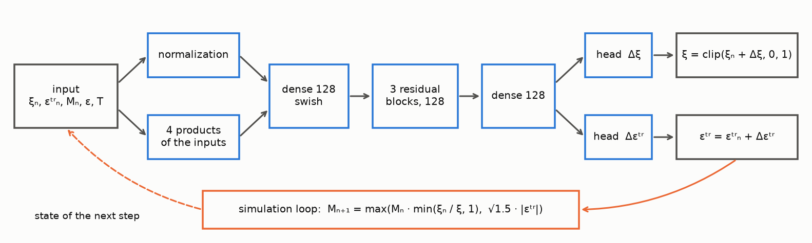
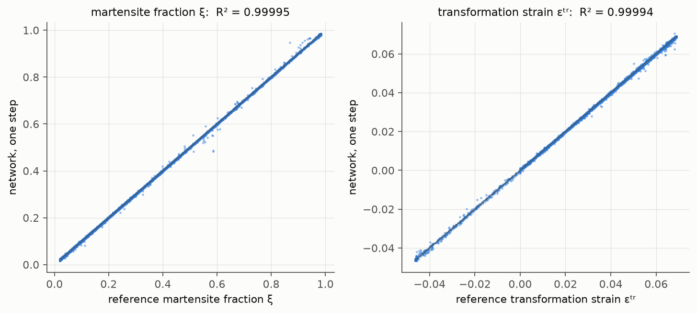
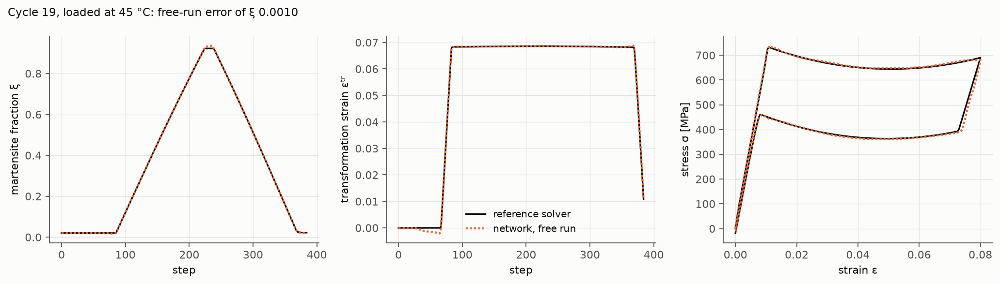
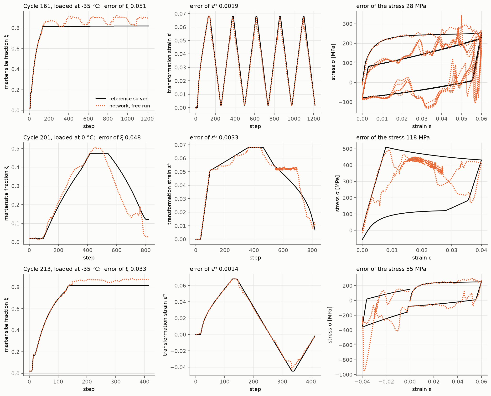
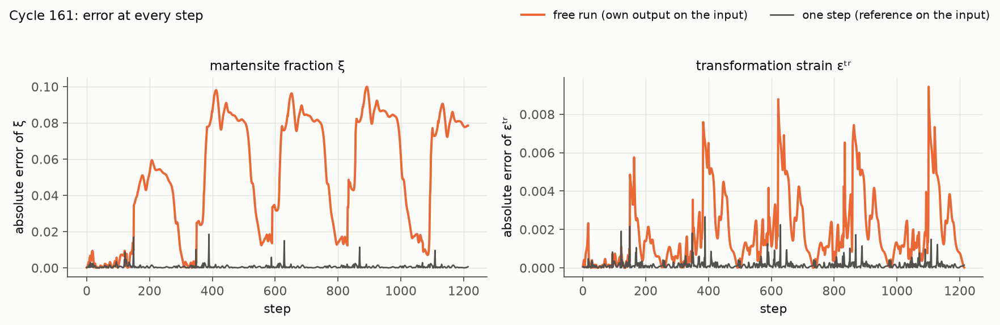
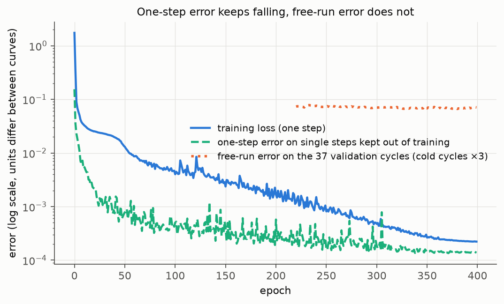

# 01 · Baseline network

**Question.** What does a network need in order to replace the solver step and stay stable when it runs on its
own output? And where does it still fail?

**Answer.** Three plain things make it stable: it predicts the change of the state instead of the state, the
loop keeps the state it feeds back inside the range of the data, and the training steps have the size of the
steps in deployment. With a simple value loss this gives a network (`v10`) that does not diverge on any of the
250 benchmark cycles and has $R^2 = 0.99995$ per step.

It still fails on some cycles. On steps where the true state does not move, the network returns a tiny
increment with a preferred sign, and over hundreds of steps this adds up to a drift. Nothing pulls the state
back: when drifted states were given to the reference solver, it left 99 % of them where they were. On the
worst cycles the stress is off by 30 to 120 MPa.

## Context

February to June 2026. Thesis sections "Základní model v10", "Zbytková chyba a expoziční zkreslení" and
"Pokusy o odstranění zbytkové chyby". The data are described in
[data/README.md](../data/README.md); the loop that feeds the network its own output is
[common/rollout.py](../common/rollout.py).

## Motivation

A first network, three dense layers trained on the mean squared error of one step, was too weak: even its
one-step accuracy was poor. Better networks fitted one step well and then failed in the loop, some of them
badly (see "What did not work"). The goal of this step was a network that is accurate for one step **and**
survives hundreds of steps on its own output, built from as few ingredients as possible.

## Method

### Network



*Shown: the layers of the network and the loop that feeds its output back as the next input. A diagram, not a result.*

The network predicts increments. The new state is formed outside it:

```math
\xi = \operatorname{clip}\big(\xi_n + \Delta\xi,\ 0,\ 1\big),
\qquad
\varepsilon^{\mathrm{tr}} = \varepsilon^{\mathrm{tr}}_n + \Delta\varepsilon^{\mathrm{tr}} .
```

"Nothing changes", the most frequent case along a real path, is then the zero output, and $\xi$ can never leave
$[0, 1]$.

Layers ([common/network.py](../common/network.py)):

1. The five inputs are normalized. In parallel, four products are computed from the raw inputs and appended:
   the elastic strain of the old state $\varepsilon - \xi_n\varepsilon^{\mathrm{tr}}_n$, the memory per unit of
   martensite $M_n/\max(\xi_n, 0.02)$, the product $(1-\xi_n)\,\varepsilon$, and the macroscopic transformation
   strain $\xi_n\varepsilon^{\mathrm{tr}}_n$. The energy contains such products, and a dense layer can only
   approximate a product with many neurons.
2. A dense layer of width 128, three residual blocks of width 128, and one shared dense layer, all with the
   swish activation.
3. Two heads (64, 32, 1 neurons), one for $\Delta\xi$ and one for $\Delta\varepsilon^{\mathrm{tr}}$. Each head
   also receives the normalized inputs directly.

The network has 138,242 trainable parameters.

### Loop

The memory variable is updated by the loop, with the rule of the constitutive model
([minimization program](../00-problem-definition/minimization-program.md)). Two properties of the loop keep the state inside the range of the
training data: $\xi$ is clipped, and the rule bounds $M$ by $\sqrt{3/2}\,\varepsilon^{\mathrm{tr}}_{\max} \approx 0.086$.

The second property was missing at first. The early loop multiplied $M$ by $\xi_n/\xi$ without the cap at 1.
During reverse transformation that factor is above 1 and $M$ grew step after step, far outside the data.
[code/check_memory_rule.py](code/check_memory_rule.py) applies both versions to the reference cycles:

| Rule | Error against the solver's $M$ (mean / largest) | Largest $M$ along the cycles |
|---|---|---|
| with $\min(\xi_n/\xi,\ 1)$ | $1.0\cdot10^{-8}$ / $3.0\cdot10^{-5}$ | 0.084 |
| without | $7.0\cdot10^{-4}$ / $0.21$ | 4.08 |

### Loss

```math
L \;=\; 2\,\frac{\big\langle(\Delta\xi - \Delta\xi^{\mathrm{ref}})^2\big\rangle}{s^2_{\Delta\xi}}
\;+\; \frac{\big\langle(\Delta\varepsilon^{\mathrm{tr}} - \Delta\varepsilon^{\mathrm{tr,ref}})^2\big\rangle}{s^2_{\Delta\varepsilon}}
\;+\; 5\,\Big\langle \max(\xi_n + \Delta\xi - 1,\ 0)^2 + \max(-\xi_n - \Delta\xi,\ 0)^2 \Big\rangle
```

$\langle\cdot\rangle$ is the mean over a batch and $s^2$ are the variances of the reference increments, so both
outputs count on the same scale. The error of $\xi$ counts twice. The last term penalizes $\xi$ outside $[0, 1]$
before the clip, so the learned map respects the limits itself.

### Training and checkpoint selection

| Setting | Value |
|---|---|
| Training pairs | 674,955 (596,145 single steps + 78,810 consecutive steps of the 176 training cycles) |
| Optimizer | Adam, batch 1,024, gradient clipped at norm 5 |
| Learning rate | warm-up over 8 % of the epochs, then cosine from $10^{-3}$ to $10^{-5}$ |
| Epochs | 400 |
| Weight averaging | exponential moving average, decay 0.95 per epoch |

The consecutive steps of the cycles are there for one reason: they have the step size of deployment
($5\cdot10^{-4}$ in strain). They enter as shuffled single pairs, not as sequences.

The checkpoint is **not** chosen by the loss. From epoch 220 on, the averaged weights are run freely over 256
windows of 80 steps cut from the validation cycles, and the weights with the smallest free-run error are kept.
Windows from cycles with a mean temperature below $-5\,^\circ$C count three times, because cold cycles are the
hardest.

### How the failures were analysed

**Two levels of accuracy, cycle by cycle.** For every benchmark cycle and for both outputs, the one-step error
(reference state on the input) and the free-run error (own output on the input) are computed
([code/drift_analysis.py](code/drift_analysis.py)).

**Where the error is made.** A step is called *flat* if the reference changes $\xi$ by less than $10^{-5}$. On
the 34 cold cycles the script measures the one-step error separately on flat and on moving steps, with its
sign, and the share of the free-run error that sits on flat steps.

**Asking the solver.** The textbook cure for a model that drifts on its own output is to collect the states it
actually visits and label them with the correct answer (DAgger, Ross et al. 2011). That costs many solver
calls, so a cheap test came first ([code/solver_probe.py](code/solver_probe.py)):

1. Run the network freely along the cold cycles. Keep the states in which its $\xi$ is off by more than 0.02.
2. Give each drifted state to the reference solver and take its next state.
3. Compare the solver's next $\xi$ and the network's next $\xi$ with the reference trajectory.

If the solver pulled a drifted state back towards the reference, its labels would teach the network to
recover. If the solver leaves the state where it is, the labels teach nothing.

## Metric

One-step accuracy and free-run mean absolute error of $\xi$ on the 250 benchmark cycles
([data](../data/README.md)). The numbers below were recomputed for this repository from
the saved network with [common/benchmark.py](../common/benchmark.py).

## Results

| Measure | $\xi$ | $\varepsilon^{\mathrm{tr}}$ |
|---|---|---|
| One step, $R^2$ | 0.99995 | 0.99994 |
| One step, MAE | 0.00085 (0.09 % of the range) | 0.00012 (0.10 %) |
| Free run, MAE, mean over 250 cycles | **0.0061** | 0.00063 |
| Free run, MAE, median over cycles | 0.0026 | – |
| Free run, $R^2$ of all trajectories | 0.9975 | 0.9979 |
| Free run, MAE, 34 cold cycles | 0.0157 | – |
| Free run, MAE, 37 held-out cycles | 0.0074 | – |

**Robustness.** 0 of 250 runs diverge. In one cycle (161, loaded at $-35\,^\circ$C) $\xi$ deviates by more than
0.2 at some step (0.22). The worst cycle is the same one, with a free-run MAE of 0.051.

### Where it works

For one step the predictions lie on the diagonal:



*Shown: the network's one-step prediction against the reference value, for $\xi$ (left) and $\varepsilon^{\mathrm{tr}}$ (right); 15,000 randomly chosen steps of the 250 benchmark cycles; the line is perfect agreement. Computed: `v10` gets the reference state at every step and predicts the next one; $R^2$ in the titles is over all 111,890 steps.*

On warm cycles the free run follows the reference closely, in both variables and in the stress:



*Shown: cycle 19, loaded at 45 °C: $\xi$ and $\varepsilon^{\mathrm{tr}}$ at every step, and the stress–strain curve. Black: reference solver. Orange: `v10` in free run. Computed: the network starts from the reference state of the first step and then receives its own output; the stress is obtained from the state with [common/stress.py](../common/stress.py), for the reference and for the network alike.*

### Where it fails

The three cycles with the largest free-run error of $\xi$. Each row is one cycle: $\xi$ and
$\varepsilon^{\mathrm{tr}}$ along the run, and the stress–strain curve computed from them.



*Shown: the three cycles with the largest free-run error of $\xi$ among the 250 (cycles 161, 201, 213), one row each: $\xi$ at every step, $\varepsilon^{\mathrm{tr}}$ at every step, and the stress–strain curve. Black: reference solver. Orange: `v10` in free run. Computed as in the previous figure; the numbers in the panel titles are mean absolute errors over the whole cycle.*

- **Cycles 161 and 213 (cold).** The network follows the transformation and then walks away from the plateau,
  where the reference keeps $\xi$ flat. $\varepsilon^{\mathrm{tr}}$ stays close to the reference. The stress does
  not: an error of a few hundredths in $\xi$ on fully oriented martensite becomes tens of MPa, and the curve
  is ragged.
- **Cycle 201 (0 °C, partial transformation).** A different failure. During unloading the network starts the
  reverse transformation too early and holds $\varepsilon^{\mathrm{tr}}$ on a plateau that the reference does not
  have. The stress is off by 118 MPa on average. This case was not analysed further.

The error does not come from any single step. Along the worst cycle the one-step error stays near zero, while
the free-run error builds up loop after loop:



*Shown: cycle 161, the absolute error of $\xi$ (left) and of $\varepsilon^{\mathrm{tr}}$ (right) at every step. Grey: one step, where `v10` gets the reference state on its input. Orange: free run, where it gets its own output. Computed against the reference solver's state at the same step.*

| Cycle | Loaded at | $\xi$: one step → free run | $\varepsilon^{\mathrm{tr}}$: one step → free run | Stress error in free run |
|---|---|---|---|---|
| 101 | $-30\,^\circ$C | 0.00094 → 0.0247 (26×) | 0.00021 → 0.00093 (4×) | – |
| 160 | $-50\,^\circ$C | 0.00062 → 0.0214 (34×) | 0.00014 → 0.0021 (15×) | – |
| 213 | $-35\,^\circ$C | 0.00086 → 0.0333 (39×) | 0.00027 → 0.0014 (5×) | 55 MPa |
| 201 | $0\,^\circ$C | 0.0021 → 0.0485 (23×) | 0.00025 → 0.0033 (13×) | 118 MPa |
| 161 | $-35\,^\circ$C | 0.00065 → 0.0505 (77×) | 0.00015 → 0.0019 (12×) | 28 MPa |

Mean absolute errors. Over all 250 cycles the free-run error is 3.6 times the one-step error for $\xi$ and 3.7
times for $\varepsilon^{\mathrm{tr}}$ (medians). Cycle 161 has a one-step error below the median of the cold
cycles and the largest free-run error of the benchmark: one-step accuracy does not rank the cycles. The stress
is computed from the state with [common/stress.py](../common/stress.py), the same function for the reference
and for the network.

The training history shows the same thing from the other side:



*Shown: three quantities recorded at every epoch of the original training of `v10`, on a log scale: the training loss on single steps, the one-step error on single steps kept out of training, and (from epoch 220) the free-run error on 256 windows of 80 steps cut from the 37 validation cycles, with cold cycles counted three times. The three curves have different units; only their trends can be compared.*

The training loss and the held-out one-step error fall until the end. The free-run error on held-out cold
cycles, measured from epoch 220, stays flat. Making one step more accurate no longer makes the run more
accurate.

### The error is made on steps where nothing happens

On the 34 cold cycles:

| Quantity | Value |
|---|---|
| Share of flat steps | 67 % |
| One-step error of $\xi$ on flat steps, mean absolute | 0.00073 |
| One-step error of $\xi$ on flat steps, mean with sign | $+0.00007$ |
| One-step error of $\xi$ on moving steps, mean absolute | 0.0017 |
| Share of the free-run error located on flat steps | 87 % |

Per step the network is *more* accurate on flat steps than on moving ones. But on a flat step the true change
is zero, so the whole prediction is error, and the error has a preferred sign. A bias of $7\cdot10^{-5}$ per
step is invisible to a squared loss (it contributes about $5\cdot10^{-9}$) and reaches several hundredths after
a few hundred steps. On moving steps the true change is much larger than the error, and a transformation back
to austenite resets $\xi$ towards zero in every loop, which is why warm cycles do not accumulate drift.

### The solver does not correct a drifted state

Recorded result of the probe, on drifted states of cold cycles. It was run with the fine-tuned network of
step 02, which drifts less than the baseline but in the same way:

| | Error of the next $\xi$ against the reference |
|---|---|
| Network, from the drifted state | 0.0306 |
| Reference solver, from the same drifted state | 0.0299 |

The solver changed $\xi$ by less than 0.005 in 99 % of the drifted states. Its answer was as far from the
reference trajectory as the network's.

This is the "no change" region of the [minimization program](../00-problem-definition/minimization-program.md)
at work. The dissipation has a kink at the previous state, so over a whole range of loads the minimizer is
exactly the previous state, whatever that state is. A drifted $\xi$ on the plateau is an equilibrium too. The
value the reference holds there is set by the path that led to it, not by the current load.

The solver calls of this test were not repeated for this repository (the solver is not public). The part
without the solver was: the fine-tuned network visits 622 drifted states on the cold cycles, with a mean error
of the next $\xi$ of 0.0307, which matches the recorded 0.0306.

## Findings

1. **A plain value loss was enough for stability.** No run diverges, with no stabilizing term in the loss.
2. **Stability came from the loop, not from the loss.** The clip of $\xi$ and the correct rule for $M$ keep the
   fed-back state inside the data. With the wrong rule and no hard cap on $M$, the same kind of network blew up
   on 69 % of the cycles (project log).
3. **Train at the step size of deployment.** A network trained only on coarse jumps had a one-step error larger
   than the true change per fine step.
4. **Select the checkpoint by a free run.** An early version shipped the wrong checkpoint and oscillated; the
   one-step loss cannot tell good weights from bad ones for the loop.
5. **The remaining error is created by iteration, not by any single step.** $R^2 = 0.99995$ per step and a
   free-run error that no longer improves. Improving one-step accuracy cannot remove it.
6. **It is a bias, not noise.** The sign is the same from step to step, so it does not average out, and
   averaging several networks with the same bias would not remove it either.
7. **There is no state to return to.** On a flat section every nearby state is an equilibrium. The solver
   itself does not undo a drift, so no training signal built from solver labels at drifted states can.
8. **A small error of the state can be a large error of the stress.** A free-run error of 0.05 in $\xi$ looks
   harmless and corresponds to 28 to 118 MPa on the worst cycles. The state error alone understates the
   problem; the later steps score the stress.
9. **Therefore the remedy must act along the network's own trajectory**, with targets taken from the reference
   trajectory, or it must stop the drift from being added in the first place.

## What did not work

Numbers in this table come from the project log. They were measured as free-run MAE of $\xi$ on the same 250
cycles, but with the earlier loop rule (a hard cap on $M$), so they are not exactly comparable with the table
above.

| Attempt | Result |
|---|---|
| Three dense layers, one-step MSE | poor one-step accuracy; under-fitted |
| Single residual network with derivative supervision, multi-phase curriculum, noise injection, rounds of retraining on failures | stable on about 5 of 8 test paths, diverged at high temperature; each retraining round fixed some failures and left 40–50 % |
| Ensemble of 5 networks predicting increments, mean of the members | free-run MAE 0.229; 52 % of the cycles blew up. Median or trimmed aggregation did not change that (0.19–0.24) |
| Same ensemble, state clamped to the range of the data, no retraining | 0.229 → 0.035. This located the cause: the state left the data, mainly through $M$ |
| Penalty on the sensitivity of the output to the input state (contraction penalty) | smooths the sharp cold transformation; one-step error about 3× higher. Dropped |
| Rollout term in the loss at the same weight as the value term, from the start | free-run error lower in parts of the cycles, one-step error 4× higher. The error moved, it did not go away |
| Derivative term in the loss (matching the solver's tangent) | dropped for this network. A later matched comparison on four network types (60 trainings) found the term made the free-run stress error worse in 40 of 48 pairs |

The plain version was better than every version with an added term. The reference solver returns to an
equilibrium by itself at every step, the network copies its outputs, and the loop keeps the state in range. An
explicit damping term then has nothing left to do except blur sharp transitions.

### Attempts to remove the drift

Free-run MAE of $\xi$; "grid" is a set of 16 cycles, one per $10\,^\circ$C, used for quick comparisons in the
project log. All numbers in this table come from that log.

| Remedy | Idea | Result | Why |
|---|---|---|---|
| Projection augmentation | Add training pairs "perturbed state → unperturbed next state", so the network learns to return | One-step error 4× higher (0.0032 against 0.00085); grid error 2× higher | The model has memory. A perturbed $\xi_n$ changes the true next state, so the target was wrong |
| DAgger with solver labels | Label the network's own drifted states with the solver | Not trained; ruled out by the probe above | The solver confirms the drifted states |
| Hold-consistency loss | Penalize any change of state under a constant load (a stand-in for "stay at equilibrium") | Cold grid cycles 0.0222 → 0.0275; grid mean 0.0054 → 0.0066 | The drift happens while the strain keeps changing and $\xi$ should stay, not under constant load. The extra term also disturbed the value fit |
| Adaptive coarse steps (tried on the fine-tuned network) | Jump over flat sections in one call, so fewer errors are added | Cold cycles 0.0061 → 0.0067 / 0.0109 / 0.0132 for jumps of 8 / 16 / 32 steps, with 38 % fewer calls | The network was trained on fine steps and is outside its data on coarse ones |

Methods that make a network stable by construction (Lipschitz or spectral bounds, contractive recurrent
networks) assume an equilibrium that attracts the state. Inside the "no change" region there is none, and a
bound on the sensitivity also blurs the sharp transformation.

## Next step

[02 · Rollout fine-tuning](../02-rollout-fine-tuning/): a short fine-tuning along the network's own trajectory
halves the free-run error without touching the one-step accuracy.

## Code

| File | What it does |
|---|---|
| [code/train_baseline.py](code/train_baseline.py) | trains the network (400 epochs; a GPU is recommended) |
| [code/check_memory_rule.py](code/check_memory_rule.py) | compares the two rules for $M$ with the reference cycles |
| [code/make_figures.py](code/make_figures.py) | the architecture, training, correlation and warm-cycle figures |
| [code/drift_analysis.py](code/drift_analysis.py) | the two error levels per cycle for both outputs, the flat-step analysis, the failing-cycle and error-growth figures; writes `results/drift_summary.json` |
| [code/solver_probe.py](code/solver_probe.py) | the solver test. **Needs the reference solver**, which is not in this repository: set `SMA_SOLVER_PATH` (see the file header) |
| [../common/network.py](../common/network.py) | the architecture and the ONNX export |
| [../common/training.py](../common/training.py) | data preparation, loss, free-run validation |
| [../common/benchmark.py](../common/benchmark.py) | scores a saved network on the 250 cycles |

From the repository root:

```
python -m common.benchmark models/v10.onnx --out 01-baseline-network/results/v10
python 01-baseline-network/code/check_memory_rule.py
python 01-baseline-network/code/make_figures.py
python 01-baseline-network/code/drift_analysis.py
python 01-baseline-network/code/train_baseline.py --out runs/v10        # full training
```

`results/v10_training_history.npz` is the history of the original training run. The training script here is a
cleaned rewrite of the original. It builds the same network (the saved weights load into it and reproduce the
ONNX model to $4\cdot10^{-7}$) and was run for a few steps only; a full retraining from this script is still to
be done. One deliberate difference: the original run selected its checkpoint with the earlier loop rule, the
script uses the corrected one.

## References

- K. He, X. Zhang, S. Ren, J. Sun (2016). Deep residual learning for image recognition. *CVPR*, 770–778.
- D. P. Kingma, J. Ba (2015). Adam: a method for stochastic optimization. *ICLR*.
- P. Ramachandran, B. Zoph, Q. V. Le (2017). Searching for activation functions. arXiv:1710.05941.
- S. Ross, G. J. Gordon, J. A. Bagnell (2011). A reduction of imitation learning and structured prediction to
  no-regret online learning. *AISTATS*, 627–635.
- C. Bonatti, D. Mohr (2022). On the importance of self-consistency in recurrent neural network models
  representing elasto-plastic solids. *Journal of the Mechanics and Physics of Solids* 158, 104697.

Full list: [../references/REFERENCES.md](../references/REFERENCES.md).
