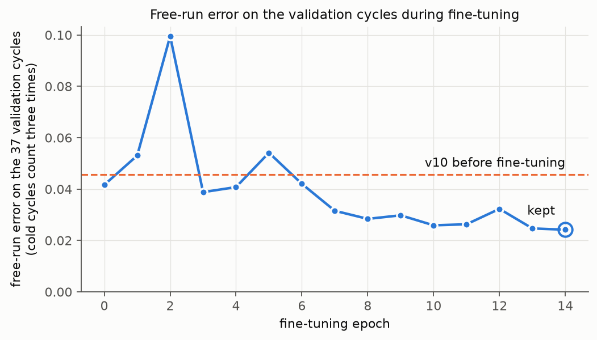
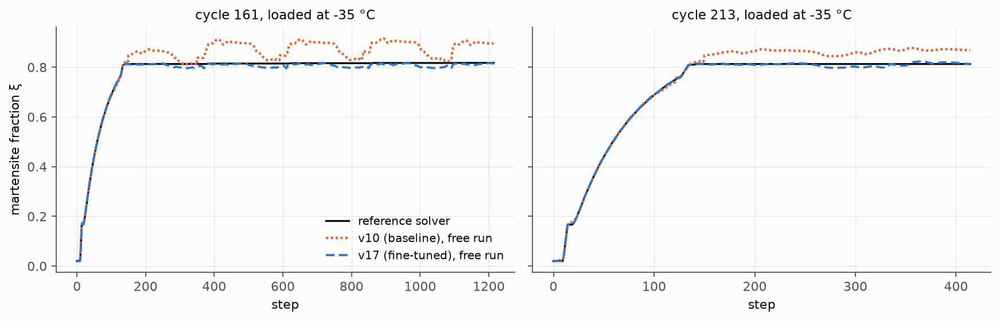
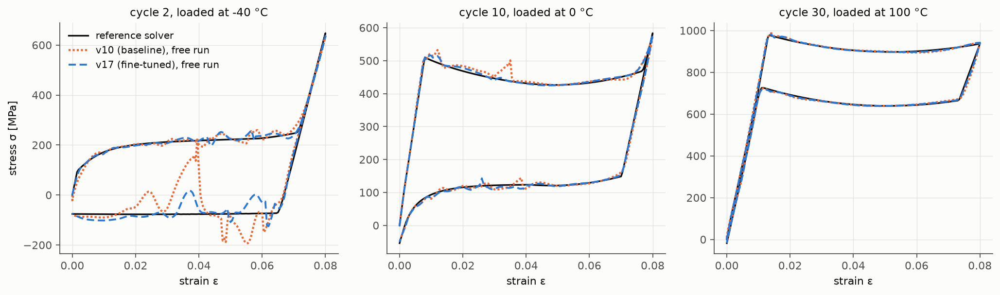
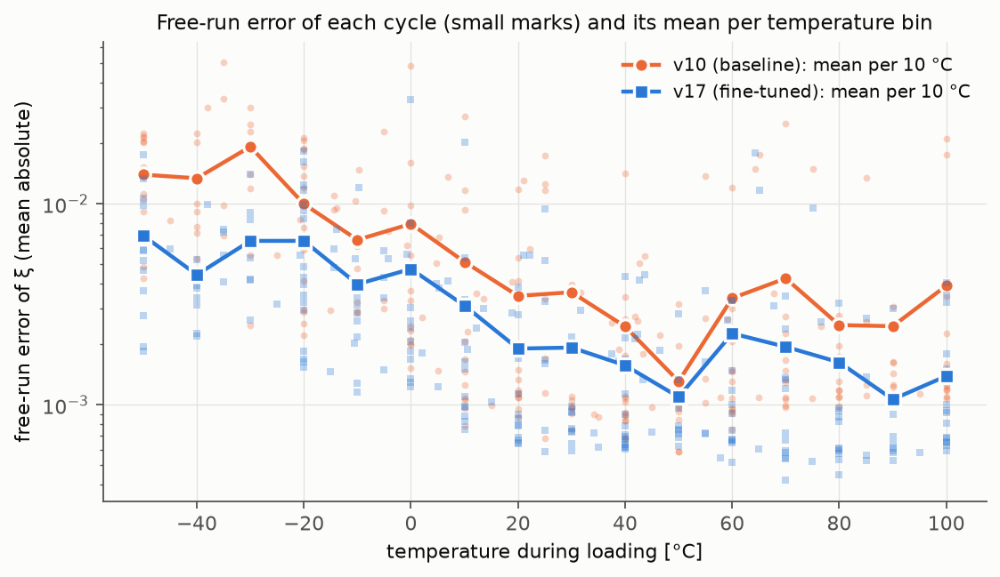
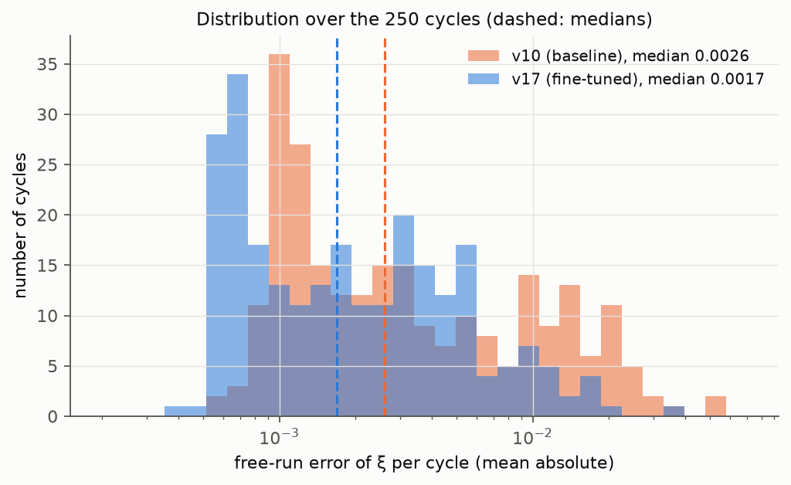

# 02 · Rollout fine-tuning

**Question.** What removes the drift of the baseline network?

**Answer.** Training it for a short time along its own trajectory. The network is unrolled for 16 steps under
the simulation loop and the distance of that trajectory from the reference is added to the unchanged one-step
loss. Fifteen epochs of this halve the free-run error (0.0061 → 0.0032), lower it by a factor of 2.5 on cold cycles, and
leave the one-step accuracy as it was. None of the 250 runs diverges. In the thesis's timing the network step
is 146 times faster than the solver step.

## Context

June 2026. Thesis sections "Úspěšné doladění (model v17)", "Výsledky" and "Diskuze"; proceedings paper.
Starts from the baseline `v10` of [step 01](../01-baseline-network/) and from the diagnosis of
[step 01](../01-baseline-network/).

## Motivation

Step 01 left two requirements for a remedy:

- it must act on the states the network itself reaches, because the error only exists there;
- its targets must not come from asking "where should this drifted state go", because that question has no
  answer on flat sections.

The reference cycles satisfy both. They give, for every step of a real path, the state the solver had there.
Unrolling the network along the same path and comparing with those states needs no new solver call.

A first attempt of this kind, with the rollout term at full weight from the start of training, had traded
one-step accuracy for free-run accuracy (step 01). So this time the term is added to an already trained
network, for a short time, with the one-step loss kept in place.

## Method

### Loss

Cut windows of $K$ consecutive steps from the training cycles. For a window, start from the reference state
and apply the loop $K$ times, each time feeding the network its own previous output:

```math
\mathbf{x}_{t} = \Phi\big(\mathbf{x}_{t-1},\ F_\theta(\mathbf{x}_{t-1},\ \varepsilon_t,\ T_t)\big),
\qquad t = 1,\dots,K .
```

$\Phi$ is the loop of [common/rollout.py](../common/rollout.py): it clips $\xi$ and updates $M$, exactly as in
deployment. The rollout term compares the unrolled states with the reference:

```math
L_{\mathrm{roll}} = \frac{1}{K}\sum_{t=1}^{K}\Big[\,2\,\frac{(\xi_t - \xi_t^{\mathrm{ref}})^2}{s^2_{\Delta\xi}}
+ \frac{(\varepsilon^{\mathrm{tr}}_t - \varepsilon^{\mathrm{tr,ref}}_t)^2}{s^2_{\Delta\varepsilon}}\Big],
\qquad
L = L_{\mathrm{one\ step}} + L_{\mathrm{roll}} .
```

$L_{\mathrm{one\ step}}$ is the loss of [step 01](../01-baseline-network/#loss), unchanged and at full weight.
It anchors the network to the map it has already learned. The gradient of $L_{\mathrm{roll}}$ flows back
through all $K$ applications of the network.

### Scheduled sampling

At each step of a window the input state is the reference state with probability $p$ and the network's own
output otherwise. $p$ falls linearly from 0.8 to 0.4 over the epochs. The network is first led mostly by the
reference and then works more and more with its own, slightly wrong, states. $p$ does not go to zero: fully
free training began to oscillate.

### Settings

| Setting | Value |
|---|---|
| Start | weights of `v10` |
| Window length $K$ | 16 steps (limited by about 2 GB of memory) |
| Windows | 40,000, drawn from the 176 training cycles; cold cycles weighted 3× |
| Batches | 128 windows + 1,024 single-step pairs per update |
| Optimizer | Adam, learning rate cosine from $2\cdot10^{-4}$ to $10^{-5}$ |
| Epochs | 15, on a CPU |
| Checkpoint | best free-run error on the validation cycles (256 windows of 80 steps, cold-weighted), checked after every epoch |

The checkpoint rule is essential. A first run that kept the last epoch made the worst cold cycle worse
(cycle 160: 0.0214 → 0.0351). Late epochs run mostly on the network's own output and can degrade.



*Shown: the free-run error after every fine-tuning epoch, measured on windows of 80 steps cut from the 37 validation cycles (cold cycles counted three times). The horizontal line is `v10` before fine-tuning; "kept" marks the epoch whose weights became `v17`. Recorded during the original fine-tuning run.*

## Metric

One-step accuracy and free-run mean absolute error of $\xi$ on the 250 benchmark cycles. Both networks were
re-scored for this repository with [common/benchmark.py](../common/benchmark.py); the table agrees with the
thesis and the proceedings paper.

176 of the 250 cycles were used for the fine-tuning, so the 37 held-out cycles are listed separately.

## Results

### Baseline against fine-tuned network

| Measure ($\xi$) | `v10` baseline | `v17` fine-tuned |
|---|---|---|
| One step, $R^2$ | 0.99995 | 0.99995 |
| One step, MAE | 0.00085 | 0.00070 |
| Free run, MAE, mean over 250 cycles | 0.0061 | **0.0032** |
| Free run, MAE, median over cycles | 0.0026 | **0.0017** |
| Free run, MAE, 34 cold cycles | 0.0157 | **0.0061** |
| Free run, MAE, 37 held-out cycles | 0.0074 | **0.0050** |
| Free run, $R^2$ of all trajectories | 0.9975 | **0.9994** |
| Free run, MAE of $\varepsilon^{\mathrm{tr}}$ | 0.00063 | **0.00027** |

**Robustness.**

| | `v10` | `v17` |
|---|---|---|
| Diverged runs (of 250) | 0 | 0 |
| Cycles with a deviation of $\xi$ above 0.2 | 1 | 0 |
| Largest deviation of $\xi$ at any step | 0.22 | 0.14 |
| Worst cycle, free-run MAE | 0.051 (cycle 161) | 0.033 (cycle 201) |

The gain on the held-out cycles (−33 %) is smaller than on all cycles (−48 %). Part of the headline
improvement is on cycles the fine-tuning has seen.

### The drift on cold cycles



*Shown: $\xi$ at every step of the cold cycles 161 and 213. Black: reference solver. Orange: baseline `v10` in free run. Blue: fine-tuned `v17` in free run. Computed by running both saved networks from the reference state of the first step on their own output.*

| Cycle | Loaded at | `v10` free-run MAE | `v17` free-run MAE |
|---|---|---|---|
| 101 | $-30\,^\circ$C | 0.0247 | 0.0026 |
| 160 | $-50\,^\circ$C | 0.0214 | 0.0037 |
| 213 | $-35\,^\circ$C | 0.0333 | 0.0041 |
| 161 | $-35\,^\circ$C | 0.0505 | 0.0072 |

### Stress–strain loops



*Shown: stress–strain curves of three simple cycles (one loading, one unloading), those loaded closest to $-40$, $0$ and $100\,^\circ$C. Black: reference solver. Orange: `v10` in free run. Blue: `v17` in free run. Computed: the stress is obtained from each state with [common/stress.py](../common/stress.py).*

The cold cycle (left) keeps a residual strain after unloading: the shape-memory regime. The warm cycle (right)
is a closed superelastic loop. `v17` follows the reference in both. On the cold cycle both networks still
wobble around the lower plateau; that is the residual error of the next figure.

### Error against temperature



*Shown: the free-run error of $\xi$ (mean absolute error over the cycle) of each of the 250 cycles against the temperature at which it is loaded (small marks), and the mean of those errors per 10 °C (lines), for `v10` and `v17`. Log scale.*

The fine-tuning helps at every temperature and most where the baseline was worst. Cold cycles remain the
hardest. Warm cycles are easy for a structural reason: $\xi$ returns to zero in every loop, which wipes out
whatever error has accumulated.



*Shown: how many of the 250 cycles have a given free-run error of $\xi$ (mean absolute error over the cycle), for `v10` and `v17`; 32 logarithmic bins; dashed lines are the medians.*

### Cost

Measured for the thesis in one simulation loop on a single CPU thread; not measured again for this repository.

| | Time per constitutive step |
|---|---|
| Reference solver | 258 ms |
| `v17`, including stress and tangent | 1.8 ms |
| `v17`, network evaluation alone | 0.044 ms |

That is a factor of 146. Most of the 1.8 ms is the tangent $\partial\sigma/\partial\varepsilon$, computed by
central differences of the network.

### Rules in the loop, without retraining

Two rules were added to the loop around the finished networks
([code/deployment_rules.py](code/deployment_rules.py), measured for this repository):

- **Dead band.** After three consecutive predicted changes of $\xi$ below 0.0015, hold the state until a
  predicted change reaches 0.004.
- **Re-anchor (oracle).** Every 20 steps, replace the state by the reference state. No real method can do this;
  it shows what an exact correction on 5 % of the steps would be worth.

| Free-run MAE of $\xi$ | All 250 | Cold | Worst cycle |
|---|---|---|---|
| `v10` | 0.0061 | 0.0157 | 0.051 |
| `v10` + dead band | 0.0047 | 0.0118 | 0.093 |
| `v10` + re-anchor (oracle) | 0.0034 | 0.0044 | 0.028 |
| `v17` | 0.0032 | 0.0061 | 0.033 |
| `v17` + dead band | 0.0022 | 0.0036 | 0.019 |
| `v17` + re-anchor (oracle) | 0.0022 | 0.0024 | 0.024 |

The dead band is free and lowers the mean error of both networks. On the baseline it also makes the worst
cycle clearly worse: once a drifted value is held, it stays. A hard rule that helps on average and can hurt in
the worst case needs a reliable detector of "nothing changes"; [step 04](../04-gated-hybrid/) builds one.

A third rule from the project log was not re-run here because it needs the solver: on a detected flat section
the **solver** computes the step instead of the network. On the five worst cold cycles it lowered the error
from 0.0076 (dead band) to 0.0032, with the solver running on 69–92 % of the steps of those cycles and about
6 % of all steps.

## Findings

1. **Train where the model fails.** The drift exists only along the network's own trajectory, and a loss
   placed there removed most of it. Every remedy that worked on a substitute for that trajectory failed
   (step 01).
2. **The targets came for free.** They are the stored reference cycles. The solver was not called again, and
   the "wrong target" problem of the failed remedies does not arise.
3. **Keep the one-step loss, select by free run.** Without the anchor the one-step accuracy degrades; without
   checkpoint selection the result was worse than the starting point.
4. **Same one-step $R^2$, half the free-run error.** Two networks that a one-step metric cannot tell apart
   differ by a factor of two in use. A high one-step $R^2$ mostly reflects how little the state changes from
   step to step.
5. **The network is fast but gives no guarantee.** It is 146 times faster than the solver, and it is accurate
   on the tested cycles. Nothing bounds its error on a path it has not seen, and exact "no change" still has
   to be imposed from outside. Of the requirements on a
   replacement solver it meets the one about speed.

## What did not work

Numbers from the project log; "grid" is a set of 16 cycles, one per $10\,^\circ$C (`v10` 0.0054, `v17` 0.0016
on that set).

| Attempt | Result |
|---|---|
| Keeping the last epoch instead of the best one | cycle 160: 0.0214 → 0.0351, worse than the baseline |
| $K = 32$ on the same machine (smaller batch and fewer windows to fit the memory) | cycle 160: 0.0037 → 0.0395. Not a clean test of the horizon |
| Curriculum up to $K = 64$ and $192$ on a GPU, with truncated back-propagation | grid 0.0024 against 0.0016 for $K = 16$. A longer horizon did not help |
| Earlier rollout fine-tuning runs with the uncapped rule for $M$ | they fought the runaway of $M$ instead of the drift |
| Scheduled sampling down to $p = 0.2$ | the loss oscillated late in training |

## Limits and next step

- The residual error sits on cold plateaus, where every nearby state is an equilibrium (step 01). Fine-tuning
  reduces the bias that causes the drift. It cannot make the plateau attract the state.
- Everything here is measured on $\xi$ and on cycles built like the training data. Part II changes both: it
  scores the stress on 40 loading paths, including kinds of paths no training set was built around.
- The model is one-dimensional. The full model has tensor-valued strain.

Next: [03 · Architectures and active learning](../03-architectures-and-active-learning/).

## Code

| File | What it does |
|---|---|
| [code/finetune_rollout.py](code/finetune_rollout.py) | the fine-tuning (15 epochs, CPU, about 2 GB of memory) |
| [code/deployment_rules.py](code/deployment_rules.py) | dead band and oracle re-anchor, scored on the 250 cycles |
| [code/make_figures.py](code/make_figures.py) | the five figures |
| [../common/training.py](../common/training.py) | one-step loss, the loop in TensorFlow, free-run validation |
| [../common/benchmark.py](../common/benchmark.py) | scores a saved network on the 250 cycles |

From the repository root:

```
python -m common.benchmark models/v10.onnx --out 01-baseline-network/results/v10
python -m common.benchmark models/v17.onnx --out 02-rollout-fine-tuning/results/v17
python 02-rollout-fine-tuning/code/make_figures.py
python 02-rollout-fine-tuning/code/deployment_rules.py
python 02-rollout-fine-tuning/code/finetune_rollout.py --out runs/v17      # the fine-tuning itself
```

`results/v17_finetuning_history.npz` is the history of the original run. The fine-tuning script is a cleaned
rewrite; it was run for a few updates only, and a full run from it is still to be done.

## References

- S. Bengio, O. Vinyals, N. Jaitly, N. Shazeer (2015). Scheduled sampling for sequence prediction with recurrent
  neural networks. *NeurIPS* 28.
- S. Ross, G. J. Gordon, J. A. Bagnell (2011). A reduction of imitation learning and structured prediction to
  no-regret online learning. *AISTATS*, 627–635.
- P. J. Werbos (1990). Backpropagation through time: what it does and how to do it. *Proceedings of the IEEE*
  78(10), 1550–1560.
- C. Bonatti, D. Mohr (2022). On the importance of self-consistency in recurrent neural network models
  representing elasto-plastic solids. *Journal of the Mechanics and Physics of Solids* 158, 104697.
- V. Stránský, P. Sedlák, M. Frost, P. Jaroš (2026). Simulations of shape memory alloys within the generalized
  standard materials thermodynamical framework and by machine learning-based models. Proceedings paper.

Full list: [../references/REFERENCES.md](../references/REFERENCES.md).
