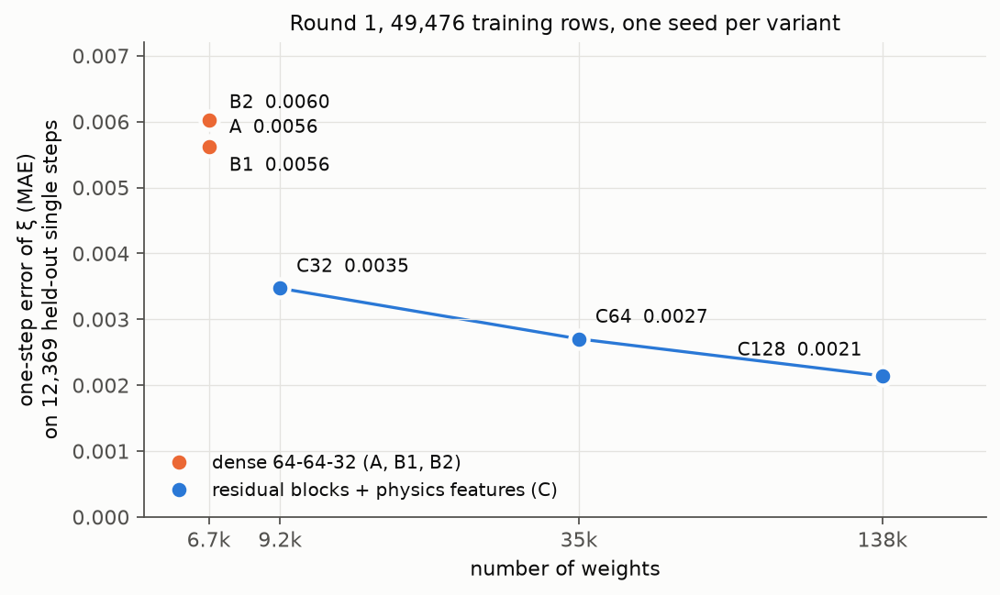
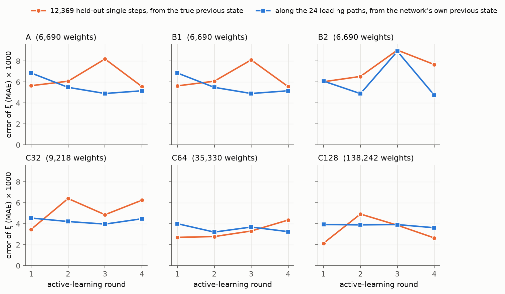
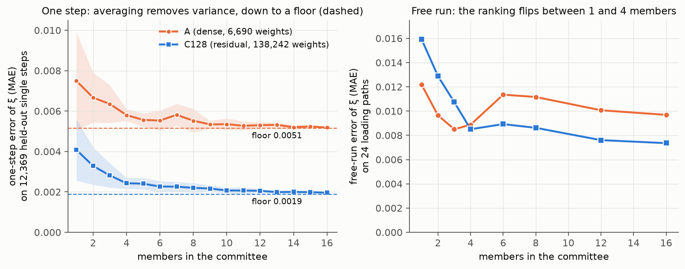
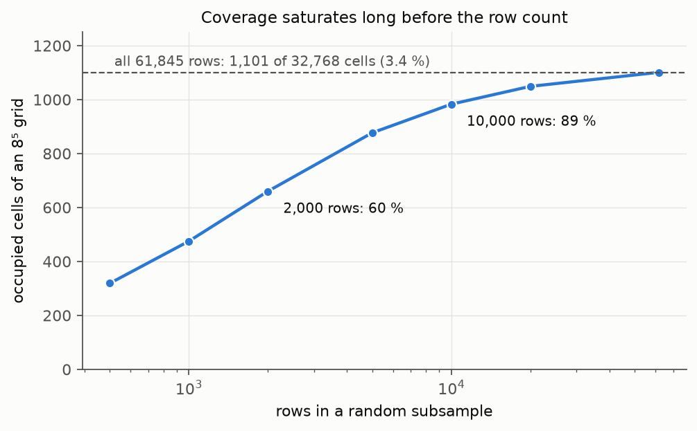

# 03 · Architectures and active learning

**Question.** Does a better network shape help? Does collecting new solver data where the network is wrong
help? Do committees of networks help?

**Answer.** The shape helps a lot, size helps little, and constraints on $\xi$ do not help. Collecting data in
rounds barely moved the fit, because the new rows fell into regions the data already covered. Committees remove
the noise between trainings and nothing else. That noise is large: the same recipe varies by ±50–60 % between
seeds, so a single training cannot rank two ideas.

## Context

5–7 October 2026, after the thesis ([step 02](../02-rollout-fine-tuning/)). From here on the reference solver
is its Python implementation, called inside the training loop. An existing active-learning loop written for
MATLAB was ported to it.

## Motivation

The thesis network was trained on a fixed dataset. Three cheap levers were still untested under equal
conditions:

1. **Architecture.** A plain dense network against the residual network with physics features of the thesis,
   at several sizes.
2. **Output constraints.** Force $\xi \in [0, 1]$ by clipping or by a sigmoid.
3. **Data.** Let the network run along loading paths, compare it with the solver at every step, and add the
   solver's answer where the two disagree.

## Method

### Networks

All variants map $[\xi_n, \varepsilon^{\mathrm{tr}}_n, M_n, \varepsilon, T]$ to
$[\xi, \varepsilon^{\mathrm{tr}}]$ and are trained with one recipe: Adam $10^{-3}$, batch 512, mean squared
error on standardized outputs, early stopping with patience 40, at most 1000 epochs
([code/networks.py](code/networks.py)).

| Variant | Shape | Weights | Constraint on $\xi$ |
|---|---|---|---|
| A | dense 64-64-32, swish | 6,690 | none |
| B1 | the weights of A | 6,690 | clipped to $[0, 1]$ after prediction |
| B2 | trunk of A, sigmoid on $\xi$ | 6,690 | inside the network |
| C32 | physics features, 3 residual blocks, 2 heads, width 32 | 9,218 | none |
| C64 | the same, width 64 | 35,330 | none |
| C128 | the same, width 128 (the thesis shape) | 138,242 | none |

The physics features are four products that appear in the energy and that a dense layer cannot form by itself:

```math
\varepsilon - \xi_n\varepsilon^{\mathrm{tr}}_n,\qquad
\frac{M_n}{\max(\xi_n,\,0.02)},\qquad
(1-\xi_n)\,\varepsilon,\qquad
\xi_n\,\varepsilon^{\mathrm{tr}}_n .
```

### Active learning along fixed paths

The network runs along 24 loading paths (tension and compression cycles, $-50$ to $100\ ^\circ$C, strain step
0.005; 2,569 steps in total). At every step the solver is called from the **network's own state**. If the two
results differ by more than 10 %,

```math
100\cdot\frac{|\xi^{\mathrm{net}} - \xi^{\mathrm{ref}}|}{\max(|\xi^{\mathrm{ref}}|,\ 0.01)} > 10
\qquad\text{or}\qquad
100\cdot\frac{|\varepsilon^{\mathrm{tr,net}} - \varepsilon^{\mathrm{tr,ref}}|}{\max(|\varepsilon^{\mathrm{tr,ref}}|,\ 0.01\,\varepsilon^{\mathrm{tr}}_{\max})} > 10 ,
```

the solver's answer becomes a training row and the solver's trajectory is followed for 10 more steps
([code/acquisition.py](code/acquisition.py)). A second trigger, "an input lies outside the min/max box of the
training data", was also active. After each pass the network is retrained on the enlarged set. Four rounds per
variant, 24 trainings, 91,001 solver calls, 32,730 new rows.

### Committees

16 networks per architecture, each trained on its own 80 % subsample with its own seed. Their predictions are
combined by the median ([code/committee.py](code/committee.py)). The error of a committee of $k$ members is
fitted by

```math
E(k) = E_\infty + \frac{b}{k} ,
```

where $E_\infty$ is the part of the error all members share. No committee size gets below it.

### Autonomous loops

Two loops chose their own loading instead of following fixed paths: a random walk driven by novelty, and a
loop that starts from only 2,000 rows and grows the dataset round by round.

## Metric

Mean absolute error of $\xi$.

- **Holdout:** one step from the true state, on 12,369 frozen rows that no variant trains on.
- **Along the paths (rounds):** one step from the network's own state, on the 24 paths.
- **Free run (committees):** the network runs alone and is compared with the true trajectory. This number
  includes accumulated drift and is larger. It is not comparable with the previous one.

"Holdout" in this step means 12,369 single solver steps that were set aside before training. They are single
steps, not loading cycles, and each is scored with the true previous state on the input. The 49,476 training
rows and the holdout come from one grid of states, split by row. Stress errors on unseen
paths start in [step 04](../04-gated-hybrid/).

## Results

### Shape matters more than size



*Shown: the one-step error of $\xi$ (mean absolute error) of six network variants against their number of weights. Computed on 12,369 single solver steps that were set aside before training (single steps, not cycles); each network gets the true previous state on its input. One training per variant, on 49,476 rows, after round 1.*

C32 has 1.4 times the weights of A and a 39 % lower error (0.0035 against 0.0056). Within the C shape, four
times the weights buy about 20 %. Each point is one training.

Both constraints fail. B1 is identical to A along the paths in every round: $\xi$ never left $[0, 1]$, so the
clip never acted. B2 is worse than A on the holdout (0.0060 against 0.0056) and had the largest single error of
any run (0.70 in round 3). About 23 % of the rows sit at saturated $\xi$, where a sigmoid has almost no
gradient.

A, B1 and B2 used all 1000 epochs in round 1 and were still improving, so they are measured slightly
undertrained. The C variants stopped by themselves after 276–380 epochs.

### Four rounds of new data

| Variant | Holdout, round 1 → 4 | Along the paths, round 1 → 4 | Steps with a trigger, round 1 → 4 |
|---|---|---|---|
| A | 0.0056 → 0.0056 | 0.0069 → 0.0052 | 48.4 % → 36.8 % |
| B1 | 0.0056 → 0.0056 | 0.0069 → 0.0052 | 48.4 % → 36.8 % |
| B2 | 0.0060 → 0.0077 | 0.0061 → 0.0047 | 30.0 % → 44.1 % |
| C32 | 0.0035 → 0.0062 | 0.0045 → 0.0045 | 26.4 % → 34.3 % |
| C64 | 0.0027 → 0.0044 | 0.0040 → 0.0032 | 18.3 % → 23.9 % |
| C128 | 0.0021 → 0.0026 | 0.0039 → 0.0036 | 17.8 % → 22.5 % |



*Shown: for each of the six variants, two errors of $\xi$ (mean absolute, ×1000) after each of the four active-learning rounds. Orange: one-step error on the 12,369 single solver steps that were set aside before training. Blue: error along the 24 loading paths, where every prediction starts from the network's own previous state. One training per variant and round.*

No variant's holdout error improved beyond noise after round 1. The error along the paths fell for the weak
networks (A −25 %) and hardly for the strong one (C128 −8 %). For every network except A and B1 the share of
steps with a trigger went **up**. A round adds 900–1,750 rows to about 50,000; that is too little to move a
global fit, and enough to disturb it.

Two defects of the acquisition rule explain part of this:

- **The box trigger never fired**: 0 of 32,730 rows. A few hundred points already span the full range of each
  variable, so an axis-aligned box sees nothing.
- **62 % of the new rows sit at zero strain.** The relative threshold is about 13 times stricter where $\xi$ is
  small (it fires at $|\Delta\xi| > 0.002$ during the initial temperature ramp and at about $0.027$ during
  loading), so the loop spent most of its budget on the least interesting states.

### Committees: variance only



*Shown: left, the one-step error of $\xi$ on the 12,369 held-out single steps for committees of 1 to 16 networks that differ only in their seed (line: median over committees of that size; band: ± one standard deviation; dashed: fitted floor). Right, the free-run error of $\xi$ on the 24 loading paths for committees of selected sizes. A committee answers with the median of its members.*

| | A | C128 |
|---|---|---|
| Single trainings, holdout error (16 seeds) | 0.0058 – 0.0137, mean 0.0077 | 0.0024 – 0.0072, mean 0.0039 |
| Half-range relative to the mean | ±51 % | ±62 % |
| Committee floor $E_\infty$ | 0.0051 | 0.0019 |
| Free run, 1 member → 16 members | 0.0122 → 0.0097 | 0.0159 → 0.0074 |
| Member spread as a warning for bad rows (AUC) | 0.76 | 0.76 |

- The ranking of the two architectures holds at every committee size on the holdout. With the noise removed, the
  floor of C128 is 63 % below that of A.
- In the free run a single C128 network is **worse** than a single A network; from four members on the
  committee of C128 is better. The free-run curve uses one ordering of the members, so its wiggles are noise.
- The spread between members flags the 10 % worst rows with an AUC of 0.76. That is usable as a warning and too
  weak to rely on.
- On the stress metric of the next step, committees of 4–16 members lowered the free-run error by 12–20 %.

Changing only the seed moves the error of a single training by up to ±50–60 % around its mean. The comparisons
in this step and in step 04 are single trainings, so only differences well beyond that range should be read as
real.

### Why more rows did not help: the reachable states are a thin set



*Shown: how many cells of an $8^5$ grid over the five inputs contain at least one row, for random subsamples of the 61,845 rows of the original dataset. Dashed: all rows. Computed by binning the rows; no network is involved.*

Binned on an $8^5$ grid over the five inputs, all 61,845 rows of the original data occupy 1,101 of 32,768 cells
(3.4 %). Three couplings hold on every row and make the set thin:
$M \ge |\varepsilon^{\mathrm{tr}}|$, $M \le \sqrt{3/2}\,\varepsilon^{\mathrm{tr}}_{\max}$ and
$|\varepsilon^{\mathrm{tr}}| \le \varepsilon^{\mathrm{tr}}_{\max}$.

- A random 2,000 rows already reach 60 % of those cells, and 10,000 rows reach 89 %.
- Of the cells hit by the 32,730 harvested rows, only 12.2 % were new.
- The harvested rows are nevertheless under-covered locally: their median distance to the nearest training row
  is 3.3 times that of a random state (0.181 against 0.054 in standardized units). A gate at the 95th
  percentile of that distance flags 32.7 % of them. The box flagged none.

**Autonomous loop from 2,000 rows** (one training per round, so the round-to-round changes are within the
noise between trainings):

| Network | Rounds | Rows at the end | Holdout error, first → last round | New cells per round |
|---|---|---|---|---|
| A | 10 | 7,997 | 0.0232 → 0.0183 | 0–9 |
| C16 | 10 | 7,993 | 0.0215 → 0.0216 | 0–18 |
| C32 | 10 | 7,944 | 0.0226 → 0.0217 | 3–14 |

The dataset quadrupled while the number of occupied cells grew from 1,007 to at most 1,081. None of the three networks improved beyond the noise between trainings.

**Random exploration.** A walk that chose each load increment by novelty ran for 47 cycles and 40,802 solver
calls. The holdout error went from 0.0035 to 0.0049. The cause was a bug: the visit map was discarded between
episodes, so the walk covered about 25 distinct cells per 200-step episode and kept returning to the same
corner. The run was stopped.

**Robustness.** No network failed (non-finite output) in any of the 24 rounds. The largest single $\xi$ error
along the paths was 0.11–0.14 in every run except B2 in round 3 (0.70). No path diverged in any committee free
run (0 of 24 at every committee size).

## Findings

1. **Give the network the products the physics uses.** The residual shape with four physics features beat a
   plain network of the same size by 39 %.
2. **Do not constrain an output that already behaves.** The clip never acted; the sigmoid hurt.
3. **One training is one draw.** ±51 % and ±62 % between seeds. Rankings need several seeds or a committee.
4. **Count covered cells, not rows.** Coverage saturated at about 10,000 rows. Rows added inside covered
   regions did nothing.
5. **An acquisition rule needs the same care as a model.** A relative threshold concentrated the harvest
   where the state is small; a bounding box cannot detect anything in a thin set.
6. **One-step and free-run rankings can disagree.** A single C128 network is better than A per step and worse
   in the free run.

## What did not work

| Idea | Result |
|---|---|
| clip $\xi$ to $[0, 1]$ | no effect |
| sigmoid on $\xi$ | worse fit, largest outlier |
| four rounds of disagreement-driven data on a 49k dataset | holdout unchanged or worse; small gain along the paths for weak networks |
| min/max box as an out-of-distribution test | fired on 0 of 32,730 rows |
| random novelty-driven exploration | holdout worse (0.0035 → 0.0049); visit map lost between episodes |
| growing a dataset from 2,000 rows | error flat for A, C16, C32 |
| committees as a way to lower the error | remove seed noise only |

Two practical problems cost more time than any of these. Training 24 networks in one process leaked memory
until the machine swapped, and one round took 314 times longer than it should; training in a subprocess fixed
it. And the two exported model formats took their inputs in different orders, which needs a permutation that
is now checked in every round.

## Next step

All variants here are smooth maps with the same blind spot: they never return "no change" exactly. More
capacity, more rounds of data and committees did not change that. [Step 04](../04-gated-hybrid/) takes the
other route: a classifier decides whether anything changes at all, and from there on the results are scored by
the stress in a free run.

## Code

| File | What it does |
|---|---|
| [code/networks.py](code/networks.py) | the five network shapes and the training recipe |
| [code/acquisition.py](code/acquisition.py) | loading paths, the disagreement rule, harvesting along a path |
| [code/committee.py](code/committee.py) | median aggregation, the $E_\infty + b/k$ fit, AUC of the member spread |
| [code/coverage.py](code/coverage.py) | occupied grid cells, nearest-neighbour distance |
| [code/make_figures.py](code/make_figures.py) | all figures, from `results/` |

```
cd code
python make_figures.py      # figures from the recorded numbers
python committee.py         # refit the committee floors
python acquisition.py       # self-test with toy steppers
python coverage.py          # self-test on synthetic points
python networks.py          # print the weight counts (needs tensorflow)
```

None of these needs the solver. `acquisition.py` takes the solver step and the network step as functions; in
the study the solver step was the reference solver, which is not part of this repository. The numbers in
`results/` are those recorded in the original runs (`rounds.csv`, `committee.json`, `autonomous_loop.csv`,
`coverage.json`, `random_exploration.json`). The code here is a cleaned rewrite and the trainings have not
been repeated with it.

## References

- B. Settles (2009). *Active learning literature survey*. Computer Sciences Technical Report 1648, University
  of Wisconsin–Madison.
- H. S. Seung, M. Opper, H. Sompolinsky (1992). Query by committee. *Proceedings of the Fifth Annual Workshop
  on Computational Learning Theory*, 287–294.
- B. Lakshminarayanan, A. Pritzel, C. Blundell (2017). Simple and scalable predictive uncertainty estimation
  using deep ensembles. *Advances in Neural Information Processing Systems* 30.
- K. He, X. Zhang, S. Ren, J. Sun (2016). Deep residual learning for image recognition. *CVPR*, 770–778.
- S. Ross, G. J. Gordon, J. A. Bagnell (2011). A reduction of imitation learning and structured prediction to
  no-regret online learning. *AISTATS*.

Full list: [../references/REFERENCES.md](../references/REFERENCES.md).
