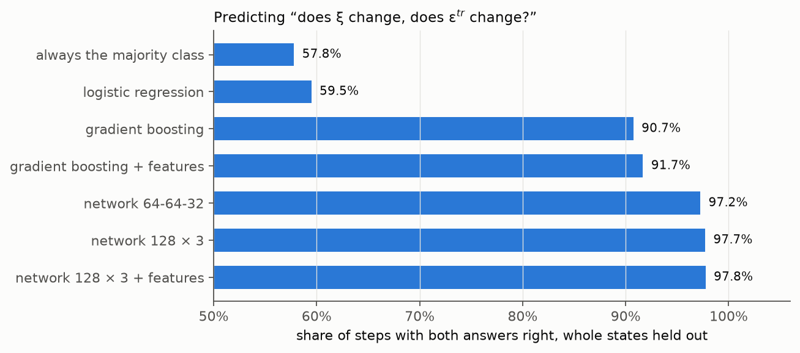
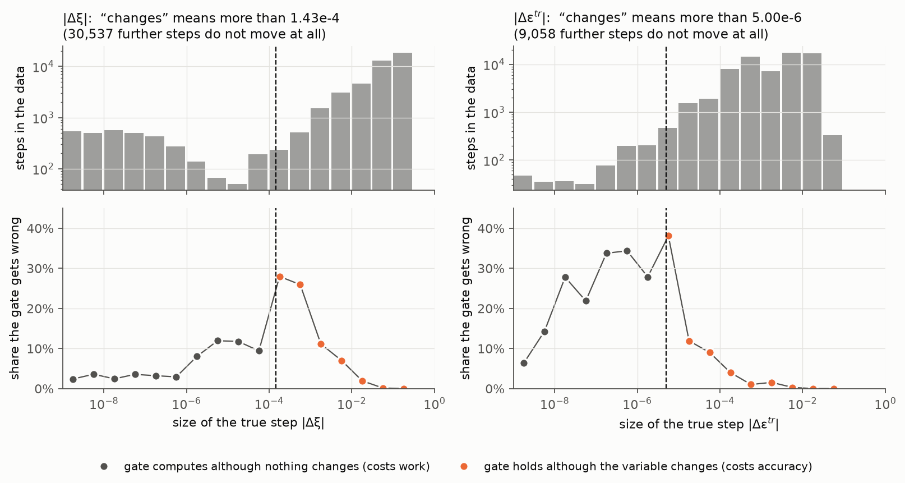
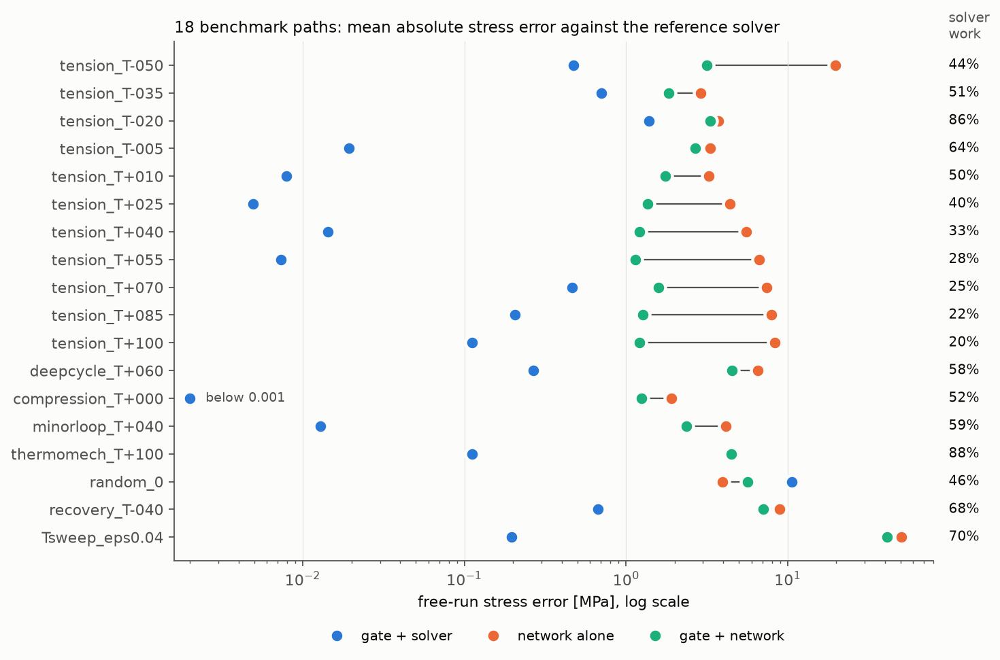
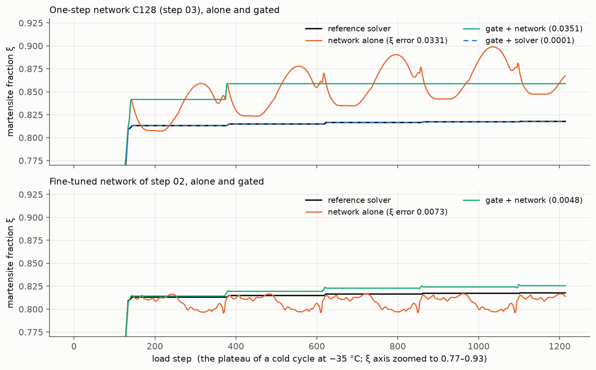

# 04 · Gated hybrid: decide first whether anything changes

**Question.** In most steps one or both internal variables do not change at all. Can a classifier decide that
first, so that the solver or a network is only called when something has to be computed?

**Answer.** Mostly. A small classifier (the gate) is right on 98 % of unseen states. With the solver behind it,
the median stress error over 18 paths is 0.15 MPa at 50 % of the solver's work, and a held variable keeps its
value exactly. A wrong "no change" is never corrected, though: six such calls leave 10.6 MPa on a random path.
The hybrid also still relies on Nelder–Mead for every step it computes, so it saves work without adding a
guarantee.

## Context

Period: 19 October to 2 November 2026. The trained networks had reached 5 to 10 MPa free-run stress error on new loading paths and were
no longer improving. This step puts a small classifier in front of the solver and in front
of a network. It uses two existing networks as they are:

- **C128**, the residual network of step 03 (138,242 weights), retrained on the single-step dataset described
  below;
- **v17**, the fine-tuned network of step 02.

## Motivation

The solution of the constitutive step has an exact "no change" region
([problem definition](../00-problem-definition/minimization-program.md)): for a whole range of loads the new
state equals the old one. Two things follow.

1. A plain network has no exact zero. It returns a tiny increment where the true increment is zero, and over
   hundreds of steps the increments add up to drift (step 01).
2. The solver spends its full budget, about 1,200 energy evaluations, even on steps where nothing changes.

Both would improve if something told us in advance, for each internal variable, **whether it changes in this
step**. That question is a binary classification, and it turns out to be much easier than predicting the new
value.

## Method

### The question

For one load step with the old state $(\xi_n, \varepsilon^{\mathrm{tr}}_n, M_n)$, mechanical strain $\varepsilon$
and temperature $T$, define two labels from the solver's answer $(\xi, \varepsilon^{\mathrm{tr}})$:

```math
c_\xi = \big[\ |\xi - \xi_n| > \tau_\xi\ \big],
\qquad
c_\varepsilon = \big[\ |\varepsilon^{\mathrm{tr}} - \varepsilon^{\mathrm{tr}}_n| > \tau_\varepsilon\ \big].
```

The thresholds are not tuned. They are what the reference solver itself can resolve. After its search, the
solver marks the transformation as active if $\varepsilon^{\mathrm{tr}}_{\max}\,|\Delta\xi| > 2\delta$ and the
reorientation as active if $|\Delta\varepsilon^{\mathrm{tr}}| > \delta$, with its tolerance $\delta = 5\cdot10^{-6}$
and $\varepsilon^{\mathrm{tr}}_{\max} = 0.07$. So

```math
\tau_\xi = \frac{2\delta}{\varepsilon^{\mathrm{tr}}_{\max}} = 1.43\cdot10^{-4},
\qquad
\tau_\varepsilon = \delta = 5\cdot10^{-6}.
```

The two differ by a factor of about 28. A step at the threshold moves the stress by roughly 0.7 MPa through
$\xi$ and 0.4 MPa through $\varepsilon^{\mathrm{tr}}$ (strain equivalent times a stiffness of 75 GPa).

### The gate

A network with two outputs, $p_\xi = P(c_\xi = 1)$ and $p_\varepsilon = P(c_\varepsilon = 1)$:

| Item | Setting |
|---|---|
| Inputs | $\xi_n$, $\varepsilon^{\mathrm{tr}}_n$, $M_n$, $\varepsilon$, $T$, standardised |
| Layers | 3 dense layers of 128 units, swish; 2 sigmoid outputs; 34,050 weights |
| Loss | binary cross-entropy, averaged over the two outputs |
| Training | Adam at $2\cdot10^{-3}$, halved after 10 epochs without improvement, batch 256, early stopping |
| Data | 78,485 solver-labelled single steps in the run-time convention (see below), 20,622 distinct previous states |
| Split | by previous state: 80 % training, 10 % early stopping, 10 % test |

"Run-time convention" means that every row is labelled exactly as the simulation loop calls the solver: the
strain is the mechanical strain (total minus thermal), and the stiffness of the old state is built at the
temperature of the step. An earlier dataset did not do this.

The split is by previous state because the data hold many rows per state: all rows of one state are either in
training or in the test set.

The trained gate is stored as plain numpy arrays in [`models/gate.npz`](models/gate.npz) (139 kB).

### The gated step

In every step the gate gives two probabilities, $p_\xi$ and $p_\varepsilon$. A variable with $p \ge 1/2$ is
computed; the other keeps its exact old value. The new state goes through the same stress routine in every run.
What computes the changing variables depends on the run.

**Solver run.** The solver minimizes the same energy $\Pi = \Psi + \mathcal{D}$, but only over the variables
that change:

```math
\begin{array}{lll}
c_\xi = 1,\ c_\varepsilon = 1: & (\xi,\ \varepsilon^{\mathrm{tr}}) = \arg\min_{\xi,\ \varepsilon^{\mathrm{tr}}} \Pi(\xi, \varepsilon^{\mathrm{tr}}) & \text{full solver} \\[4pt]
c_\xi = 0,\ c_\varepsilon = 1: & \xi = \xi_n,\quad \varepsilon^{\mathrm{tr}} = \arg\min_{\varepsilon^{\mathrm{tr}}} \Pi(\xi_n, \varepsilon^{\mathrm{tr}}) & \text{search over one variable} \\[4pt]
c_\xi = 1,\ c_\varepsilon = 0: & \varepsilon^{\mathrm{tr}} = \varepsilon^{\mathrm{tr}}_n,\quad \xi = \arg\min_{\xi} \Pi(\xi, \varepsilon^{\mathrm{tr}}_n) & \text{search over one variable} \\[4pt]
c_\xi = 0,\ c_\varepsilon = 0: & \xi = \xi_n,\quad \varepsilon^{\mathrm{tr}} = \varepsilon^{\mathrm{tr}}_n & \text{nothing runs}
\end{array}
```

| Gate prediction | Energy evaluations in the step |
|---|---:|
| neither changes | 0 |
| one variable changes | 452 |
| both change | 1,204 |

**Network run.** One forward pass gives both outputs. The output of a held variable is discarded.

### Controls

| Control | What it checks | Result |
|---|---|---|
| Gate forced to "changes", solver | the shared state → stress routine reproduces the solver | 0.000 MPa (tension at $40\,^\circ$C) |
| Gate forced to "changes", C128 | the wrapper reproduces the earlier benchmark of C128 | 5.553 MPa, identical (same path) |
| Perfect gate (decisions read from the reference path, threshold $10^{-5}$), solver | the one-variable search is accurate | 0.07 MPa (random walk) and 0.009 MPa (constrained recovery); only these two paths were run |
| v17 alone in this code | the strain conversion for v17 is right | $\xi$ error 0.0073 and 0.0041 on cycles 161 and 213, the values of its own benchmark |

## Metric

Free-run mean absolute stress error in MPa against the reference solver.

- **Paths:** 18 of the 40 benchmark paths (11 tension cycles from $-50$ to $100\,^\circ$C, and 7 others
  including constrained recovery, a temperature sweep and a random walk), plus 2 cold cycles with a long plateau
  from the 250-cycle benchmark in `data/` (cycles 161 and 213). The other 22 paths were not run.
- **Solver work:** energy evaluations of the gated run divided by those of the full solver on the same path.
  Wall-clock time was not measured.
- **Classifier:** accuracy on previous states that were not used for training.
- **Seeds:** one gate, one seed of each network. This step has no seed statistics.

## Results

### 1. The change can be predicted

First study, on the original 61,845-row dataset (1,493 previous states, about 40 rows per state), one threshold
of $10^{-5}$ for both variables, 5-fold cross-validation with whole states held out:

| Model | $\xi$ changes | $\varepsilon^{\mathrm{tr}}$ changes | both right |
|---|---:|---:|---:|
| always the majority class | 63.9 % | 89.0 % | 57.8 % |
| logistic regression (with two hand-made features) | 66.4 % | 89.0 % | 59.5 % |
| gradient boosting | 93.2 % | 97.3 % | 90.7 % |
| network 64-64-32 | 98.5 % | 98.7 % | 97.2 % |
| **network 128 × 3** | **98.8 %** | **98.8 %** | **97.7 %** |



*Shown: the share of single steps on which a classifier answers both questions correctly (does $\xi$ change, does $\varepsilon^{\mathrm{tr}}$ change), for six classifiers. Computed by 5-fold cross-validation in which all rows that share a previous state stay in the same fold, so every score is on states the classifier has not seen.*

The last row is the same model scored the leaky way. The difference of 0.9 points looks small, but it hides
more than a third of the true error (2.3 % of steps wrong, reported as 1.4 %).

The result does not depend on the threshold: with $10^{-6}$, $10^{-4}$ and $10^{-3}$ the "both right" score of
the 128 × 3 network is 97.4 %, 97.1 % and 97.1 %.

### 2. The deployed gate

On its 7,623 test rows the gate with per-variable thresholds scores 98.2 % for $\xi$, 97.6 % for
$\varepsilon^{\mathrm{tr}}$ and 96.2 % for both.

To see every row once as test data, five gates were trained, each without one fifth of the states:

| Out of 78,485 steps | $\xi$ | $\varepsilon^{\mathrm{tr}}$ |
|---|---:|---:|
| correctly held | 36,282 | 9,264 |
| correctly computed | 40,842 | 67,220 |
| computed although nothing changes (costs work) | 682 | 881 |
| **held although the variable changes (costs accuracy)** | **679** | **1,120** |



*Shown: top, how many steps of the data have a true change of a given size, for $\xi$ and for $\varepsilon^{\mathrm{tr}}$ (log scale); bottom, the share of those steps on which the gate is wrong, split into "computes although nothing changes" and "holds although the variable changes". Computed from the gate's answers on states it was not trained on.*

The errors sit at the threshold. Steps of $\xi$ just above $\tau_\xi$ are held wrongly 26 to 28 % of the time;
large steps are almost never missed. This is the weak spot of the whole method, because a wrongly held variable
is not corrected later.

### 3. Gated simulation on 18 benchmark paths

Median stress error in MPa:

| Run | 11 tension cycles | 8 mixed paths | all 18 | worst path |
|---|---:|---:|---:|---:|
| C128 alone | 5.55 | 5.60 | 5.10 | 50.7 |
| Gate + C128 | 1.59 | 4.52 | 2.10 | 41.4 |
| v17 alone | 11.8 | 21.5 | 15.9 | 220 |
| Gate + v17 | 9.8 | 20.1 | 14.9 | 113 |
| **Gate + solver** | **0.11** | **0.23** | **0.15** | **10.6** |

Gate + solver needs a median of 50 % of the full solver's energy evaluations (40 % on the tension cycles, 58 %
on the mixed paths).



*Shown: the free-run stress error (mean absolute difference from the reference solver, log scale) on each of 18 loading paths, for three ways of computing a step: gate + solver, the network C128 alone, and gate + C128. Each variant runs along the whole path on its own output.*

- Gate + C128 is better than C128 alone on 17 of 18 paths. The exception is the random walk.
- Gate + solver stays below 0.5 MPa on 14 of 18 paths.
- v17 fails on the cold paths with or without the gate (95 MPa on tension at $-50\,^\circ$C). These paths use a
  strain step of $5\cdot10^{-3}$; v17 was trained at $5\cdot10^{-4}$. Step 01 found the same sensitivity to
  step size, but it was not tested directly here.

The full per-path table is in [`results/summary.md`](results/summary.md).

**Where the saving comes from.** Number of steps in each case:

| Path | Steps | neither | only $\xi$ | only $\varepsilon^{\mathrm{tr}}$ | both |
|---|---:|---:|---:|---:|---:|
| tension at $100\,^\circ$C | 152 | 120 | 0 | 3 | 29 |
| random walk | 150 | 7 | 0 | 118 | 25 |
| cold cycle 161 | 1,215 | 51 | 2 | 976 | 186 |

On a simple tension cycle most steps are skipped. On long paths with a plateau, $\varepsilon^{\mathrm{tr}}$
moves on almost every step while $\xi$ holds, so the saving comes from the cheaper one-variable searches.

### 4. Cold cycles with a long plateau

These are the cycles on which the networks of steps 01 to 02 drifted: cooling to $-35\,^\circ$C, then loading
loops with $\xi$ on a plateau near 0.81 for about a thousand steps.

| Run | Cycle 161: $\xi$ error | stress error [MPa] | Cycle 213: $\xi$ error | stress error [MPa] |
|---|---:|---:|---:|---:|
| C128 alone | 0.0331 | 14.1 | 0.0179 | 8.9 |
| Gate + C128 | 0.0351 | 12.5 | 0.0198 | 9.8 |
| v17 alone | 0.0073 | 10.9 | 0.0041 | 14.8 |
| Gate + v17 | 0.0048 | 10.5 | 0.0014 | 10.1 |
| **Gate + solver** | **0.0001** | **0.3** | **0.0002** | **0.3** |

Gate + solver used 46 % and 55 % of the full solver's work.



*Shown: $\xi$ on the plateau of the cold benchmark cycle 161 (the axis is zoomed to 0.77–0.93), one panel per network (C128 above, `v17` below). Black: reference solver. Then the network alone, gate + network, and in the upper panel gate + solver, all in free run. The numbers in the legend are the mean absolute errors of $\xi$ over the cycle.*

The gate stops the wandering on the plateau. It cannot repair a wrong value: C128 overshoots $\xi$ during the
first loading (0.84 against 0.81), and the gate then holds that value. The cause of the overshoot was not
established.

### 5. Where it hurts

On the random walk the gate holds $\xi$ on six steps where it should have changed. The error in $\xi$ is small
(0.003 on average), but it is never corrected, and the stress error stays at 7 to 25 MPa for the rest of the
path (10.6 MPa on average). With a perfect gate the same code gives 0.07 MPa at 25 % of the solver's work. So
the reduced search is not the problem; six wrong answers of the classifier are.

On the same path the gate is too cautious for $\varepsilon^{\mathrm{tr}}$: it computes on 85 steps where a
perfect gate would hold. That only costs work.

| Path | C128 alone | Gate + C128 | Gate + solver | Perfect gate + solver |
|---|---:|---:|---:|---:|
| random walk | 3.95 | 5.69 | 10.64 | 0.07 |
| constrained recovery at $-40\,^\circ$C | 8.95 | 7.08 | 0.67 | 0.009 |
| temperature sweep at 4 % strain | 50.7 | 41.4 | 0.20 | not run |

The temperature sweep shows the other limit: when the network itself is wrong (50 MPa), holding some of its
outputs does not help much.

**Robustness.** No run diverged (178 recorded runs). Worst path: 10.6 MPa for gate + solver (random walk),
41.4 MPa for gate + C128 (temperature sweep), 113 MPa for gate + v17 (constrained recovery).

## Findings

1. **Whether a variable changes is far easier to learn than how much.** A 34,050-weight classifier is right on
   98 % of unseen states, while the regression networks plateaued (step 03).
2. **An exact hold removes drift.** A held variable keeps its old value to the last digit. This is the
   structure that smooth networks lack.
3. **With the solver behind it, the gate gives the solver's accuracy at half the work** on most paths:
   0.15 MPa median over 18 paths at 50 % of the energy evaluations.
4. **The two kinds of gate error are not symmetric.** Computing without need costs work. Holding by mistake
   costs accuracy for the rest of the path, because inside the no-change region nothing pulls the state back.
   Six such mistakes produce the worst result of this step.
5. **Per-variable treatment matters.** Running a one-variable search when only one variable changes cut the
   error on constrained recovery from 10.5 to 1.8 MPa (0.67 MPa with the per-variable thresholds) and the
   median work to 50 %.

## What did not work

- **One threshold for both variables.** The first gate used $10^{-5}$ for $\xi$ and
  $\varepsilon^{\mathrm{tr}}$. Per-variable thresholds improved gate + C128 (median 2.47 → 2.10 MPa, random walk
  11.3 → 5.7, constrained recovery 16.4 → 7.1). They did not improve gate + solver (0.105 → 0.154 MPa).
- **Running the full solver whenever either variable changes.** That was the first rule. It left 10.5 MPa on
  constrained recovery, where one variable is wrongly held while the other is solved.
- **A threshold in stress units.** Tried before the solver-based thresholds. The labels hardly moved when the
  tolerance went from 0.005 to 2 MPa, because the step sizes in the data are close to bimodal.
- **Hand-made physics features for the gate.** They added less than 0.1 points (97.7 % → 97.8 %).
- **Trees.** Single decision trees needed thousands of leaves, and a random forest came close to the network.
  Those runs were one-off and their script was not kept, so no numbers are quoted here.
- **The gate as a repair for a network.** It cannot correct values (C128 on the cold cycles) and it cannot
  rescue a network outside its training range (v17 on coarse steps, C128 on the temperature sweep).

## Next step

Open on the gate itself:

- **A cautious cutoff.** Calling "changes" already at $p \ge 0.2$ instead of $0.5$ trades work for fewer wrong
  holds. A partial sweep with the first (single-threshold) gate, on four paths only, moved the random walk from
  9.3 to 4.3 MPa at 34 % more evaluations and constrained recovery from 1.8 to 0.47 MPa. It was not completed.
- Solver-exact activity flags as training labels, the remaining 22 benchmark paths, seed statistics, and a
  wall-clock measurement that includes the gate.

The larger issue is different. **The hybrid still calls the reference solver.** It halves the cost, but every
step that is computed is computed by Nelder–Mead, with no convergence guarantee and no optimality check. The gate adds a second source of error on
top: a learned decision with a 2 % error rate that nothing downstream can detect.

The gate learns from data something the energy already contains. The no-change region is the set of loads for
which the minimizer of $\Pi$ is the old state. [Step 05](../05-proximal-gradient-solver/) derives that region
from the energy itself: the proximal step returns the old state exactly there, so the decision "does it change"
and the new value come out of one formula, and no classifier is needed.

## Code

| File | What it does | Needs |
|---|---|---|
| [`code/gate.py`](code/gate.py) | the gate as a numpy function; thresholds; a small demo | numpy |
| [`code/make_figures.py`](code/make_figures.py) | all figures and `results/summary.md` from the recorded results | numpy, matplotlib |
| [`code/train_gate.py`](code/train_gate.py) | trains the gate; `--out-of-fold` for the five-fold predictions | TensorFlow, scikit-learn, the single-step dataset (not stored in this repository) |
| [`code/classifier_study.py`](code/classifier_study.py) | the model comparison with whole states held out | TensorFlow, scikit-learn, the dataset of step 03 |
| [`code/gated_simulation.py`](code/gated_simulation.py) | one gated free run: solver or ONNX network behind the gate, controls | **the reference solver** |

```
cd code
python gate.py
python make_figures.py

# needs the reference solver, which is not part of this repository
SMA_SOLVER_PATH=/path/to/solver python gated_simulation.py solver tension_T+100
SMA_SOLVER_PATH=/path/to/solver python gated_simulation.py solver recovery_T-040 --oracle
```

Recorded results in [`results/`](results/):

| File | Content |
|---|---|
| `path_results.csv` | one row per path and run: errors, steps computed, energy evaluations, solver work |
| `reference_paths.json` | the 20 loading paths with the reference solution |
| `traces.json` | trajectories behind the figures |
| `classifier_study.json` | scores of the first study |
| `gate_report.json`, `gate_out_of_fold.json`, `gate_errors_by_step_size.csv` | scores of the deployed gate |
| `gate_report_single_threshold.json` | scores of the first gate (one threshold $10^{-5}$) |
| `summary.md` | the tables above, generated |

## References

- S. Ross, G. J. Gordon, J. A. Bagnell (2011). A reduction of imitation learning and structured prediction to
  no-regret online learning. *AISTATS*, 627–635. Why errors of a model that runs on its own output compound.
- J. C. Simo, T. J. R. Hughes (1998). *Computational Inelasticity*. Springer. The classical scheme for
  rate-independent materials decides "elastic or not" with a trial step before it computes anything; the gate
  is a learned version of that decision.
- P. Sedlák, M. Frost, B. Benešová, T. Ben Zineb, P. Šittner (2012). Thermomechanical model for NiTi-based shape
  memory alloys including R-phase and material anisotropy under multi-axial loadings. *International Journal of
  Plasticity* 39, 132–151.

Full list: [../references/REFERENCES.md](../references/REFERENCES.md).
