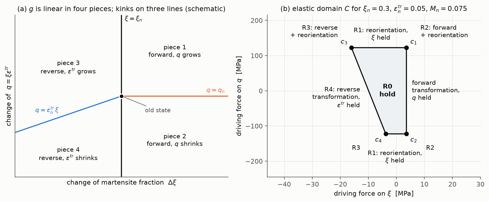
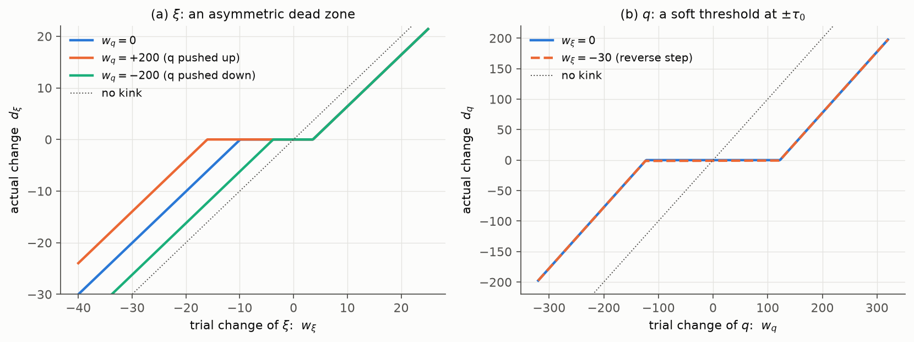

# The exact prox for both unknowns

The prox of the kinked part $g$ has a closed form: **the trial increment minus its projection onto a trapezoid.**
The trapezoid is the elastic domain of the material. This is the two-variable version of the soft threshold, and
it is the return mapping of computational plasticity.

Code: `prox_g` and `project_polygon` in [code/prox_gradient_solver.py](code/prox_gradient_solver.py). The
recorded output of the checks quoted on this page is in [results/prox_checks.txt](results/prox_checks.txt).

## What goes in and what comes out

| | Symbol | Meaning |
|---|---|---|
| in | $w = (w_\xi,\ w_q)$ | trial increment: how far the gradient step would move the state from the old state if there were no dissipation |
| in | $Y_F^0,\ Y_R,\ \tau_0,\ \varepsilon^{\mathrm{tr}}_n$ | constants of $g$, fixed during the time step ([page 01](01-from-nelder-mead-to-proximal-gradient.md)) |
| in | $t$ | step size |
| **out** | $d = (d_\xi,\ d_q)$ | actual increment; the new iterate is $(\xi_n + d_\xi,\ q_n + d_q)$; $d = 0$ means the state holds |

The prox solves

```math
d = \arg\min_{d}\ \Big\{\ g(d) + \frac{\lVert d - w\rVert^2}{2t}\ \Big\} .
```

## Step 1: $g$ is the largest of four linear functions

Each absolute value is the larger of two lines, $|x| = \max\{x, -x\}$. So each branch of $g$ is the larger of two
lines:

```math
\begin{aligned}
\text{line 1:}\quad & Y_F^0\,d_\xi + \tau_0\,d_q &&= \langle c_1, d\rangle && \text{forward, } q \text{ grows}\\
\text{line 2:}\quad & Y_F^0\,d_\xi - \tau_0\,d_q &&= \langle c_2, d\rangle && \text{forward, } q \text{ shrinks}\\
\text{line 3:}\quad & -Y_R\,d_\xi + \tau_0\,(d_q - \varepsilon^{\mathrm{tr}}_n d_\xi) &&= \langle c_3, d\rangle && \text{reverse, } \varepsilon^{\mathrm{tr}} \text{ grows}\\
\text{line 4:}\quad & -Y_R\,d_\xi - \tau_0\,(d_q - \varepsilon^{\mathrm{tr}}_n d_\xi) &&= \langle c_4, d\rangle && \text{reverse, } \varepsilon^{\mathrm{tr}} \text{ shrinks}
\end{aligned}
```

```math
c_1 = \big(Y_F^0,\ \tau_0\big),\quad c_2 = \big(Y_F^0,\ -\tau_0\big),\quad
c_3 = \big({-Y_R} - \tau_0\varepsilon^{\mathrm{tr}}_n,\ \tau_0\big),\quad c_4 = \big({-Y_R} + \tau_0\varepsilon^{\mathrm{tr}}_n,\ -\tau_0\big).
```

One maximum over all four is enough, because the forward lines lie above the reverse lines exactly on the
forward side:

```math
\text{line 1} - \text{line 3} = \big(Y_F^0 + Y_R + \tau_0\varepsilon^{\mathrm{tr}}_n\big)\,d_\xi,
\qquad
\text{line 2} - \text{line 4} = \big(Y_F^0 + Y_R - \tau_0\varepsilon^{\mathrm{tr}}_n\big)\,d_\xi .
```

Both brackets are positive when $Y_F^0 + Y_R \ge \tau_0|\varepsilon^{\mathrm{tr}}_n|$. That always holds:
$Y_F^0 + Y_R = \Delta S\,(A_f - M_s) + \sigma_{\mathrm{reo}} M_n$, the first term is 6 MPa, and
$M_n \ge \sqrt{3/2}\,|\varepsilon^{\mathrm{tr}}_n|$ by the definition of the memory variable. Hence

```math
g(d) = \max_{i = 1,\dots,4}\ \langle c_i,\ d\rangle .
```

A maximum of linear functions is convex. **Checked** on 6,000 random points: the maximum equals the two-branch
formula to $10^{-15}$.

## Step 2: the four slopes are the corners of the elastic domain

```math
C = \operatorname{conv}\{c_1, c_2, c_3, c_4\}
```

is a trapezoid in the plane of driving forces (MPa). It contains every pair of driving forces that the
dissipation resists without anything moving.



*Shown: (a) a schematic of the plane of the two increments $(\Delta\xi, \Delta q)$, cut by the kink lines into the four regions in which $g$ is linear; (b) the elastic domain $C$, a trapezoid in the plane of the two driving forces. Computed: (b) from the threshold formulas of this page for the state $\xi_n = 0.3$, $\varepsilon^{\mathrm{tr}}_n = 0.05$, $M_n = 0.075$.*

| Edge of $C$ | Equation | Threshold that is reached |
|---|---|---|
| right, vertical | force on $\xi$ $= Y_F^0$ | forward transformation starts |
| top and bottom, horizontal | force on $q$ $= \pm\tau_0$ | reorientation starts |
| left, slanted | (force on $\xi$) $+\ \varepsilon^{\mathrm{tr}}_n\,$(force on $q$) $= -Y_R$ | reverse transformation starts; slanted because $\varepsilon^{\mathrm{tr}}$ is kept, which couples $\xi$ and $q$ |

For the example state in the figure the corners are $(3.6,\ 122.5)$, $(3.6,\ -122.5)$, $(-16.0,\ 122.5)$ and
$(-3.8,\ -122.5)$ MPa: about 20 MPa wide and 245 MPa tall.

## Step 3: the prox is a projection

At the minimum the slopes balance. The slope of the quadratic term is $(d - w)/t$. The slope of $g$ at $d$ is
the corner $c_i$ of the line that is largest there, or, where several lines meet, any point of $C$ between those
corners. So $d = w - t\,c$ for some $c \in C$ that is a slope of $g$ at $d$.

Such a $c$ gives the largest value of $\langle c, d\rangle$ among all points of $C$. Inserting $d = w - tc$:

```math
\big\langle\, t c' - t c,\ \ w - t c \,\big\rangle \le 0 \qquad \text{for every } c' \in C .
```

This is the defining property of the closest point: $tc$ is the point of the scaled trapezoid $tC$ nearest to
$w$. Therefore

```math
\boxed{\ d = w - P_{tC}(w)\ }
```

where $P_{tC}(w)$ is the projection of $w$ onto $tC$. If the trial increment lies inside $tC$, nothing moves.
If it lies outside, the state moves by the distance from $w$ to the trapezoid, away from its nearest face. This
is Moreau's decomposition applied to a function whose conjugate is the indicator of $C$.

**Sanity check with the soft threshold.** For $g(d) = \lambda|d|$ the slopes are $\pm\lambda$, $C$ is the
interval $[-\lambda, \lambda]$, the projection is a clip, and $d = w - \operatorname{clip}(w, -t\lambda, t\lambda)$
is the soft threshold.

## The faces are the regimes

The face of the trapezoid that the projection lands on decides what moves. These are the regimes of the material: hold, reorientation, forward and reverse transformation. A learned
model has to classify them from data ([step 04](../04-gated-hybrid/) does that for "changes or not"); here they
follow from the projection.

| Closest point of $tC$ | Increment $d$ | Regime |
|---|---|---|
| $w$ itself (inside) | $0$ | R0: everything holds |
| top or bottom edge | $\big(0,\ w_q \mp t\tau_0\big)$ | R1: reorientation, $\xi$ held |
| right edge | $\big(w_\xi - tY_F^0,\ 0\big)$ | forward transformation, $q$ held ($\varepsilon^{\mathrm{tr}}$ diluted to $q_n/\xi$) |
| corner $tc_1$ or $tc_2$ | $w - tc_{1,2}$ | R2: forward transformation with reorientation |
| left edge | $\dfrac{w_\xi + \varepsilon^{\mathrm{tr}}_n w_q + tY_R}{1 + (\varepsilon^{\mathrm{tr}}_n)^2}\,\big(1,\ \varepsilon^{\mathrm{tr}}_n\big)$ | R4: reverse transformation, $\varepsilon^{\mathrm{tr}}$ held |
| corner $tc_3$ or $tc_4$ | $w - tc_{3,4}$ | R3: reverse transformation with reorientation |

The hold test is three inequalities:

```math
|w_q| \le t\,\tau_0, \qquad w_\xi \le t\,Y_F^0, \qquad w_\xi + \varepsilon^{\mathrm{tr}}_n\,w_q \ge -t\,Y_R .
```

In the first iteration $w/t$ is the driving force at the old state, so these are the three physical criteria:
reorientation, forward transformation, reverse transformation.

Plotted one output at a time, the prox looks like the familiar activations. The other trial value only shifts
the thresholds.



*Shown: the two outputs of the prox for the same state as in the previous figure. (a) The actual change of $\xi$ against the trial change $w_\xi$, for three values of the trial change of $q$. (b) The actual change of $q$ against its trial change $w_q$, for two values of $w_\xi$. Dotted: what a step without kinks would return. Computed with `prox_g` of [code/prox_gradient_solver.py](code/prox_gradient_solver.py), step size 1.*

Left: $d_\xi$ is a dead zone. Its right end is $Y_F^0 = 3.6$; its left end is $-9.9$ at $w_q = 0$ and moves to
$-16.0$ or $-3.8$ when $q$ is pushed up or down. Right: $d_q$ is a soft threshold at $\pm\tau_0$. For a reverse
step the flat part is not exactly zero but $d_q = \varepsilon^{\mathrm{tr}}_n\,d_\xi$, which keeps
$\varepsilon^{\mathrm{tr}} = q/\xi$ unchanged; on this scale the two curves coincide.

## Its derivative, and what that gives a finite-element code

The prox is piecewise linear. With $n$ the unit outward normal of the edge:

```math
\frac{\partial d}{\partial w} =
\begin{cases}
0, & w \text{ inside (hold)}\\
n\,n^{\mathsf T}, & \text{closest point on an edge}\\
I, & \text{closest point at a corner.}
\end{cases}
```

This is the two-variable version of the soft threshold's derivative (0 in the band, 1 outside). With a metric
$H$ (below) the same holds in the transformed coordinates.

Two uses. Training needs it to back-propagate through the layers ([plan](plan-learned-unrolling.md)). And a
finite-element code needs the tangent $\partial\sigma/\partial\varepsilon$ of the whole step: with this Jacobian
the tangent can be derived from the same equations that produce the state, by differentiating the fixed-point
condition, instead of being assembled afterwards from thresholds and numerical second derivatives as in the
reference solver. The tangent itself is not implemented here yet.

## One step size per direction

The curvature of $f$ differs by orders of magnitude between $\xi$ and $q$
([page 03](03-guarantees-and-open-gaps.md)), so the quadratic term needs a metric $H$ (a positive definite
$2\times2$ matrix) instead of $1/t$:

```math
d = \arg\min_{d}\ \Big\{\, g(d) + \tfrac12\,(d - w)^{\mathsf T} H\,(d - w) \Big\} .
```

Factor $H = L L^{\mathsf T}$ and change coordinates to $e = L^{\mathsf T} d$. The quadratic term becomes
$\tfrac12\lVert e - \omega\rVert^2$ with $\omega = L^{\mathsf T} w$, and $g$ becomes the maximum of the lines
with corners $L^{-1}c_i$. That is the problem above with $t = 1$ and a transformed trapezoid:

```math
d = L^{-\mathsf T}\Big(\omega - P_{L^{-1}C}(\omega)\Big), \qquad \omega = L^{\mathsf T} w .
```

It is still one projection onto a four-sided polygon. For a diagonal $H = \operatorname{diag}(1/t_\xi,\ 1/t_q)$
this is a stretch of the two axes. The hold test and the regimes are unchanged.

## Checks

| Check | Cases | Result |
|---|---|---|
| optimality certificate: $c = H(w - d)$ lies in $C$ and $\langle c, d\rangle = g(d)$ | 20,000 each for Euclidean, diagonal and full metrics | 0 failures |
| closed form against a direct numerical minimization | 300 | largest relative excess $7\cdot10^{-14}$ |
| hold test (three inequalities) against the projection | 20,000 | 0 mismatches |
| every increment equals one of the face formulas | 20,000 | 0 exceptions |
| Jacobian against finite differences | 3,000 | at most $3\cdot10^{-7}$ |
| gradient with respect to a corner, $\partial d/\partial c_i = -t\,I$ when the closest point is that corner | 2,018 | at most $4\cdot10^{-10}$ |

## References

- J. J. Moreau (1965). Proximité et dualité dans un espace hilbertien. *Bulletin de la Société Mathématique de
  France* 93, 273–299.
- N. Parikh, S. Boyd (2014). Proximal algorithms. *Foundations and Trends in Optimization* 1(3), 127–239.
- J. C. Simo, T. J. R. Hughes (1998). *Computational Inelasticity*. Springer. (Return mapping as a closest-point
  projection onto the elastic domain.)
