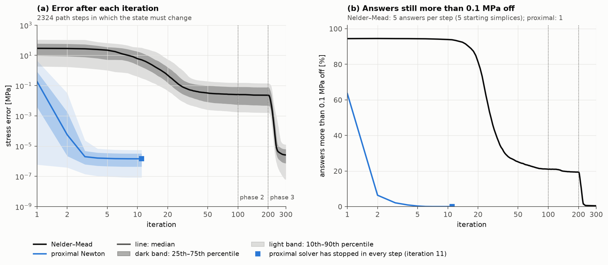

# Numerical checks and the Newton step

The reference solver minimizes the step energy with Nelder–Mead (downhill simplex). That method has three
problems here:

1. **It is slow.** About 650 energy evaluations per step on the public model
   ([page 04](04-benchmark-against-nelder-mead.md)).
2. **Its answer cannot be trusted on its own.** It runs a fixed budget of iterations, has no test of optimality,
   and has no convergence theory for an energy with kinks. Nothing tells whether a returned state is the minimum.
3. **It fails where the kinks are.** The old state is a vertex of its starting simplex and lies in a kink of the
   energy. Near a threshold the simplex can collapse onto it and report "no change" although the material should
   move. Its errors sit on the kink lines, where one unknown is held (page 04).

This page shows two things: that the proximal solver finds the minimum (checked against brute force), and why
the plain ISTA step of [page 01](01-from-nelder-mead-to-proximal-gradient.md), with one step size, does not: the
step needs a metric matched to the curvature of the energy. The Newton step is the fastest such metric; one step
size each along $\xi$ and $\varepsilon^{\mathrm{tr}}$ also converges, more slowly.

## Checked numerically (public one-dimensional model)

[code/verify_solver.py](code/verify_solver.py) compares the solver with a brute-force minimum of the same energy
(grid search with repeated zooming). Output: [results/solver_verification.txt](results/solver_verification.txt).

The solver used is the iteration of page 01 with the Hessian of $f$ as the metric (a proximal Newton step) and
step halving.

| Test | Steps | Iterations: median / 99th pct / max | Solver energy above brute force | Largest stress difference |
|---|---|---|---|---|
| steps along 60 loading paths (strain cycles and temperature cycles) | 2,602 | 4 / 8 / 14 | at most $2\cdot10^{-14}$ MPa | 0.022 MPa |
| random states with very large load jumps | 1,000 | 8 / 17 / 20 | at most $2\cdot10^{-14}$ MPa | 0.26 MPa |

In no step did the solver end above the brute-force minimum. In 3 of the 3,602 steps the brute force ended
slightly above the solver (by at most $4\cdot10^{-3}$ MPa of energy); the stress differences in the last column
come from those steps. No step failed to converge.

Limits of these numbers: they are for the public one-dimensional energy and measure agreement with that
energy's own minimum. The loading paths are generated by the script and cut at 60 steps, so 19 of the 45
strain cycles end before the strain returns to zero. The comparison with Nelder–Mead is on
[page 04](04-benchmark-against-nelder-mead.md).

### Against Nelder–Mead, iteration by iteration

[code/benchmark_convergence.py](code/benchmark_convergence.py) runs both solvers on the 2,324 path steps in which the
state must change and reads out the answer after every iteration. The truth of each step and the Nelder–Mead
implementation are those of the benchmark on [page 04](04-benchmark-against-nelder-mead.md). Output:
[results/benchmark_convergence.txt](results/benchmark_convergence.txt).



*Shown: the stress error after each iteration, against the best known minimum of the step, on the public energy. Black: Nelder–Mead with the schedule of the reference solver, all five starting simplices, read out after every one of its 300 iterations (best vertex of the simplex). Blue: the proximal Newton solver, drawn until iteration 11, when it has stopped in every step (square); a step that has stopped keeps its final answer. (a) Line: the median error; dark band: 25th to 75th percentile; light band: 10th to 90th percentile. (b) Percentage of answers still more than 0.1 MPa off. Dotted lines: the start of Nelder–Mead's phases 2 and 3. Computed with [code/benchmark_convergence.py](code/benchmark_convergence.py); figure by [code/make_figures.py](code/make_figures.py).*

The proximal solver brings the median error below 0.1 MPa after 2 iterations and 99 % of the answers after 4;
from iteration 7 on no answer is more than 0.1 MPa off, and it stops after a median of 4 and at most 11
iterations. Nelder–Mead needs 27 iterations to bring the median below 0.1 MPa. Its first two phases then stall:
they re-expand collapsed simplices, which keeps 19 % of the answers more than 0.1 MPa off until phase 3 starts
at iteration 200. After all 300 iterations 0.4 % of its answers are still more than 0.1 MPa off.

## Why one step size is not enough

Plain ISTA takes the step $u^{k+1} = \operatorname{prox}_{tg}\big(u^k - t\,\nabla f(u^k)\big)$ with one number
$t \le 1/L$, where $L$ is the largest curvature of $f$. The curvatures of $f$ in the two unknowns differ by orders of
magnitude. From the Hessian below,

```math
\frac{\partial^2 f}{\partial q^2} = \frac{1}{s(\xi)} + \frac{\varphi''}{\xi} \approx E(\xi) + \frac{9\,000\ \text{MPa}}{\xi},
\qquad
\frac{\partial^2 f}{\partial \xi^2} = \frac{\sigma^2\,\Delta s^2}{s(\xi)} + \frac{(\varepsilon^{\mathrm{tr}})^2\,\varphi''}{\xi} + h_\pm + \text{barrier} ,
```

with $\Delta s = 1/E_M - 1/E_A$. The first is the stiffness of the material, tens of GPa and more. The second is
the hardening $h_\pm = 12$ MPa plus terms that are small away from the barriers. At the solutions of the 2,602 path
steps the curvature ranges from 12 to $7\cdot10^{5}$ MPa along $\xi$ and from $5.6\cdot10^{4}$ to
$3.3\cdot10^{8}$ MPa along $q$; the condition number of the Hessian reaches $1.4\cdot10^{6}$.

One common $t$ is set by the stiff direction $q$, so $\xi$ moves too slowly by the ratio of the two curvatures:
a median of 480 at the solutions of the path steps, more than 6,000 in a tenth of them. One step size per unknown
fixes the scale but not the coupling: the off-diagonal term $\partial^2 f/\partial\xi\,\partial q$ is often
almost as large as the geometric mean of the diagonal ones, and two numbers cannot follow it: $f$ has a narrow
valley that runs between the axes (section "Four step rules compared"). The valley is sharpest where
$\lvert\varepsilon^{\mathrm{tr}}\rvert$ is at its limit and its barrier inflates $\varphi''$: all 526 path steps in
which the steps for $\xi$ and $q$ did not converge end there.

## From the ISTA step to the Newton step

The Newton step is the ISTA iteration with one change: the number $t$ becomes the matrix $H^{-1}$. Five steps
lead from one to the other. Notation: $u = (\xi, q)$, $s = u - u^k$ is the change in one iteration,
$\nabla f = \nabla f(u^k)$, and $H = \nabla^2 f(u^k)$ is the Hessian at the current point.

**Step 1 · Write the ISTA step out.** Put the trial state $v = u^k - t\,\nabla f$ into the prox:

```math
u^{k+1} = \arg\min_u\ \Big\{\, g(u - u_n) + \frac{1}{2t}\,\big\lVert u - u^k + t\,\nabla f \big\rVert^2 \Big\} .
```

**Step 2 · Expand the square: ISTA minimizes a model of $f + g$.**

```math
\frac{1}{2t}\,\lVert s + t\,\nabla f\rVert^2 = \frac{1}{2t}\,\lVert s\rVert^2 + \nabla f^{\mathsf T} s + \frac{t}{2}\,\lVert\nabla f\rVert^2 .
```

The last term does not depend on $u$, so dropping it, or adding the constant $f(u^k)$, does not change the
minimizer:

```math
u^{k+1} = \arg\min_u\ \Big\{\, \underbrace{f(u^k) + \nabla f^{\mathsf T} s + \tfrac12\, s^{\mathsf T}\,\tfrac{I}{t}\, s}_{\text{model of } f} \;+\; g(u - u_n) \Big\} .
```

The first three terms are a quadratic model of $f$ around $u^k$, with the same curvature $1/t$ in every
direction. ISTA minimizes this model plus the exact $g$.

**Step 3 · Give the model the true curvature.** The second-order Taylor expansion of $f$ is
$f(u^k) + \nabla f^{\mathsf T} s + \tfrac12\, s^{\mathsf T} H s$. Replace $I/t$ by $H$:

```math
u^{k+1} = \arg\min_u\ \Big\{\, f(u^k) + \nabla f^{\mathsf T} s + \tfrac12\, s^{\mathsf T} H\, s \;+\; g(u - u_n) \Big\} .
```

This is the only real change; the rest is algebra.

**Step 4 · Complete the square in the metric $H$.** With $a = H^{-1}\nabla f$,

```math
\tfrac12\,(s + a)^{\mathsf T} H\,(s + a) = \tfrac12\, s^{\mathsf T} H s + \nabla f^{\mathsf T} s + \tfrac12\,\nabla f^{\mathsf T} H^{-1}\nabla f ,
```

so $\nabla f^{\mathsf T} s + \tfrac12\, s^{\mathsf T} H s$ equals $\tfrac12 (s + H^{-1}\nabla f)^{\mathsf T} H\,(s + H^{-1}\nabla f)$
up to a constant. Dropping the constants and putting back $s = u - u^k$:

```math
u^{k+1} = \arg\min_u\ \Big\{\, g(u - u_n) + \tfrac12\,(u - v)^{\mathsf T} H\,(u - v) \Big\},
\qquad v = u^k - H^{-1}\nabla f(u^k) .
```

**Step 5 · Measure from the old state.** Put $u = u_n + d$, $u^k = u_n + d^k$ and $v = u_n + w$, as on
[page 02](02-exact-joint-prox.md). Then $u - v = d - w$, and the two steps read side by side:

```math
\begin{aligned}
\text{ISTA:}\quad & w = d^k - t\,\nabla f(u^k), && d^{+} = \arg\min_d \Big\{ g(d) + \tfrac12\,(d - w)^{\mathsf T}\,\tfrac{I}{t}\,(d - w) \Big\} \\
\text{Newton:}\quad & w = d^k - H^{-1}\nabla f(u^k), && d^{+} = \arg\min_d \Big\{ g(d) + \tfrac12\,(d - w)^{\mathsf T} H\,(d - w) \Big\}
\end{aligned}
```

With $H = I/t$ the Newton step is exactly the ISTA step. The same matrix appears twice, as $H^{-1}$ in the
gradient step and as $H$ in the prox; otherwise the fixed point is not the minimum. In words: ISTA minimizes
"linearized $f$ + round bowl + exact $g$", the Newton step minimizes "second-order Taylor expansion of $f$ +
exact $g$". $H$ must be positive definite, or the model of step 3 has no minimum. In $(\xi, q)$ this holds because
$f$ is convex there, one more reason to work in $q$ instead of $\varepsilon^{\mathrm{tr}}$. In the literature the
method is the proximal Newton method (Lee, Sun and Saunders 2014).

### The step as computed

**1. Gradient and Hessian of $f$** at the current point. The gradient is on
[page 01](01-from-nelder-mead-to-proximal-gradient.md), step 2. With the compliance
$s(\xi) = (1-\xi)/E_A + \xi/E_M$, $\Delta s = 1/E_M - 1/E_A$, $\sigma = (\varepsilon - q)/s$ and
$\varepsilon^{\mathrm{tr}} = q/\xi$:

```math
H = \begin{bmatrix} a & b \\ b & c \end{bmatrix}, \qquad
\begin{aligned}
a &= \frac{\sigma^2\,\Delta s^2}{s} + \frac{(\varepsilon^{\mathrm{tr}})^2\,\varphi''}{\xi} + h_\pm + B''(\xi) \\
b &= \frac{\sigma\,\Delta s}{s} - \frac{\varepsilon^{\mathrm{tr}}\,\varphi''}{\xi} \\
c &= \frac{1}{s} + \frac{\varphi''}{\xi}
\end{aligned}
```

$\varphi$, $\varphi'$ and $\varphi''$ are taken at $\varepsilon^{\mathrm{tr}}$ and include the barrier on
$\lvert\varepsilon^{\mathrm{tr}}\rvert$; away from it $\varphi'' = (E_{\mathrm{int}}c_\pm^2 + 3E_{\mathrm{incl}})/\varepsilon^{\mathrm{tr}}_{\max}$
is a constant on each side (tension, compression). $B$ is the barrier on $\xi$. The $\varphi$ terms come from
$\xi\,\varphi(q/\xi)$, whose Hessian is
$(\varphi''/\xi)\begin{bmatrix}(\varepsilon^{\mathrm{tr}})^2 & -\varepsilon^{\mathrm{tr}}\\ -\varepsilon^{\mathrm{tr}} & 1\end{bmatrix}$.
This matrix is singular along $(1,\ \varepsilon^{\mathrm{tr}})$: that is the valley described above.

**2. Newton trial point.**

```math
w = d^k - H^{-1}\nabla f(u^k), \qquad H^{-1} = \frac{1}{ac - b^2}\begin{bmatrix} c & -b \\ -b & a \end{bmatrix} .
```

**3. Exact prox in the metric $H$.** Factor $H = LL^{\mathsf T}$, transform the trapezoid of corners $c_i$ to
corners $L^{-1}c_i$, subtract from $L^{\mathsf T}w$ its projection onto the transformed trapezoid, and transform
back
([page 02](02-exact-joint-prox.md), "One step size per direction"). It is one projection onto a four-sided
polygon, with no inner iteration. The same step in one line:

```math
d^{+} = d^k - H^{-1}\big(\nabla f(u^k) + c^\ast\big), \qquad
c^\ast = \arg\min_{c \in C}\ \big\lVert c - \big(H d^k - \nabla f(u^k)\big)\big\rVert_{H^{-1}} .
```

It is a Newton step on $f + \langle c^\ast, d\rangle$, where $c^\ast$ is the dissipative force the projection
picks: inside $C$ the step holds, on an edge one unknown moves, at a corner both do. This is the return mapping of
plasticity, in the energy's own metric. At $d^k = 0$ the step holds exactly when $-\nabla f(u_n) \in C$.

**4. Step halving.** Try $\alpha = 1, \tfrac12, \tfrac14, \dots$ (at most 30 times) and accept the first
$d^{k+1} = d^k + \alpha\,(d^{+} - d^k)$ whose energy $f + g$ is not higher than that of $d^k$.

**5. Stop** when $\lvert\Delta\xi\rvert \le 10^{-11}$ and $\lvert\Delta q\rvert \le 10^{-12}$. Each iteration
costs one evaluation of $f$, $\nabla f$ and $H$, plus one for every halving.

## Four step rules compared

[code/verify_solver.py](code/verify_solver.py) ran four step rules on the same steps. The exact prox and the
step halving are the same in all four; only the matrix $H$ changes (the step is $H^{-1}$, and the prox is taken in
the metric $H$). The Newton step may use 200 iterations, the others 2,000.

| Step size | 2,602 path steps: iterations median / 99th pct / max | not converged | 1,000 random states: iterations median / 99th pct / max | not converged |
|---|---|---|---|---|
| one common step, $t = 1/L$ with $L$ the largest curvature | 2,000 / 2,000 / 2,000 | 1,546 (59 %) | 2,000 / 2,000 / 2,000 | 805 (81 %) |
| one step per unknown, for $\xi$ and $q$ | 26 / 2,000 / 2,000 | 526 (20 %) | 27 / 2,000 / 2,000 | 131 (13 %) |
| one step per unknown, for $\xi$ and $\varepsilon^{\mathrm{tr}}$ | 13 / 184 / 212 | 0 | 22 / 205 / 232 | 0 |
| Newton step, $H = \nabla^2 f$ (the default) | 4 / 8 / 14 | 0 | 8 / 17 / 20 | 0 |

The last two rows find the same minimum: neither is above the brute-force minimum in any step (by more than
$3\cdot10^{-14}$ MPa of energy), and their stress differences from brute force are the ones in the table at the
top of this page. The first two rows stop far from it in the steps that did not converge, with stress errors up
to 620 MPa (one common step) and 180 MPa (steps for $\xi$ and $q$).

**Why the pair of unknowns matters.** One step per unknown means: measure the curvature of $f$ along two
directions and step along each with its own size,

```math
t_i = \frac{1}{(1+\rho)\,a_i}, \qquad a_i = b_i^{\mathsf T}\,\nabla^2 f\; b_i, \qquad
\rho = \frac{\lvert b_1^{\mathsf T}\,\nabla^2 f\; b_2\rvert}{\sqrt{a_1 a_2}} ,
```

where $\rho$ between 0 and 1 says how strongly the two directions are coupled. The factor $1+\rho$ makes the
step safe (the resulting $H$ bounds the Hessian from above), and what is left of the conditioning after the
scaling is $(1+\rho)/(1-\rho)$.

- For $\xi$ and $q$ the directions are the axes. The term $\xi\,\varphi(q/\xi)$ of the energy has no curvature
  along the line on which $\xi$ changes at fixed $\varepsilon^{\mathrm{tr}}$ (there it is linear in $\xi$) and
  the large curvature $\varphi''/\xi$ across it. This valley runs in the direction $(1,\ \varepsilon^{\mathrm{tr}})$,
  between the axes. At the solutions of the path steps $\rho$ is above 0.99 in 24 % of the steps (largest
  0.9998), which leaves a condition number of up to 12,000. The iteration zigzags across the valley.
- For $\xi$ and $\varepsilon^{\mathrm{tr}}$ the directions are $b_1 = (1,\ \varepsilon^{\mathrm{tr}})$ ("$\xi$ at
  fixed $\varepsilon^{\mathrm{tr}}$") and $b_2 = (0,\ \xi)$ ("$\varepsilon^{\mathrm{tr}}$ at fixed $\xi$"), because
  $q = \xi\,\varepsilon^{\mathrm{tr}}$. They follow the valley. $\rho$ has a median of 0.21 and is at most 0.88,
  which leaves a condition number of at most 15.

The problem is still posed in $(\xi, q)$, where it is convex, and the prox is the same polygon projection;
only the directions of the two step sizes are those of the model's own unknowns.

**What the simpler step costs.** Against the Newton step it needs about three times the iterations in a typical
path step (13 against 4) and fifteen times in the worst one (212 against 14). In energy evaluations the median
on the path steps is 20 against 5 and the largest 245 against 47.

## References

- J. D. Lee, Y. Sun, M. A. Saunders (2014). Proximal Newton-type methods for minimizing composite functions.
  *SIAM Journal on Optimization* 24(3), 1420–1443.
