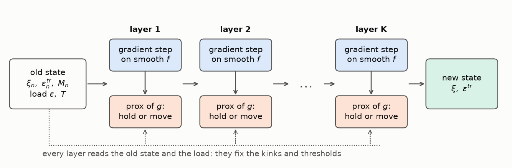

# Plan: unrolling the solver into a network

**Status: plan only.** Nothing on this page has been implemented, trained or run. The verified parts it builds
on are the exact prox, its Jacobian and the corner gradient ([page 02](02-exact-joint-prox.md)).

## From an iteration to a network

Unrolling means two decisions.

1. **Stop after a fixed number of iterations $K$**, with no convergence test. The cost of one time step is then
   fixed and known in advance.
2. **Give the copies of the iteration trainable parameters**, so that a few layers do the work of many
   iterations.

This is the step from ISTA to LISTA (Gregor and LeCun, 2010).



*Shown: one time step written as a network of $K$ identical layers, each a gradient step followed by the projection. A diagram, not a result.*

| | Quantity |
|---|---|
| in (known) | load $\varepsilon, T$; old state $\xi_n,\ \varepsilon^{\mathrm{tr}}_n,\ M_n$ |
| inside | $u^k = (\xi^k, q^k)$, the output of layer $k$; $u^0 = u_n = (\xi_n,\ \xi_n\varepsilon^{\mathrm{tr}}_n)$ |
| **out** | $\xi = \xi^K$, $\ \varepsilon^{\mathrm{tr}} = q^K/\xi^K$ |

One layer, with a metric $H_k$ ([page 02](02-exact-joint-prox.md), last section):

```math
w^k = u^{k-1} - u_n - H_k^{-1}\,\nabla f\big(u^{k-1}\big),
\qquad
u^k = u_n + \operatorname{prox}^{H_k}_{g}\big(w^k\big).
```

The gradient step computes a trial increment $w^k$ from the old state. The prox, the trapezoid projection,
turns it into the actual increment. The prox plays the role of the activation function.

Compared with LISTA there is one structural difference. In sparse coding $f$ is quadratic, so the part before
the activation is linear and can be stored as two matrices. Here $f$ contains $E(\xi)$ and $\varphi$, so the
gradient has to be computed from the energy or replaced by a learned function. That choice defines the levels.

## Four levels

| Level | Computed from the physics at run time | Learned | Learned numbers ($K = 6$) | Follows |
|---|---|---|---|---|
| **L0** | gradient $\nabla f$, corners of $C$, metric from the curvature | nothing | 0 | the untrained reference of TISTA and ADMM-Net |
| **L1** | gradient, corners | the metric of every layer | 12 with two step sizes per layer, 18 with a full $2\times2$ metric | TISTA |
| **L2** | gradient, corner formulas | metric, and scale factors on $Y_F^0$, $Y_R$, $\tau_0$ per layer | 30 to 36 | ADMM-Net (learned shrinkage) |
| **L3** | nothing from the energy | a small shared network $g_\phi$ in place of $\nabla f$; metric; corners | about 1,400 | LISTA |

- **L0** answers how many exact iterations are needed. It has nothing to train and is the reference every other
  level must beat. It is the converged solver of this step stopped after $K$ iterations; that fixed-$K$ run is
  not part of this repository yet.
- **L1** addresses the main practical weakness, the step sizes. TISTA showed that one learned number per layer
  already gives large gains.
- **L2** lets the corners move a little. That can absorb the differences between the model as written and the
  reference implementation (six-component stiffness, averaged memory variable, barriers).
- **L3** is the blind network: no energy at run time.

**A correction from the runs of this step.** The original plan for L1 was two step sizes per layer, one per
unknown. On the public model that works only for the right pair of unknowns
([page 03](03-guarantees-and-open-gaps.md), section "Four step rules compared"). Step sizes for $\xi$ and $q$ left 20 % of
the path steps unconverged after 2,000 iterations, because those two directions are strongly coupled. Step
sizes for $\xi$ and $\varepsilon^{\mathrm{tr}}$ converged in every step. L1 should therefore learn two step
sizes per layer that act along $\xi$ and $\varepsilon^{\mathrm{tr}}$, started from the curvatures of $f$ in
those directions; a full symmetric $2\times2$ metric per layer (three numbers, started from the Hessian of $f$)
is the richer alternative. The prox handles both exactly.

## The blind network (L3)

The layer keeps its form; only the gradient is replaced:

```math
w^k = u^{k-1} - u_n - H_k^{-1}\, g_\phi\big(\varepsilon,\ T,\ \xi_n,\ \varepsilon^{\mathrm{tr}}_n,\ M_n,\ u^{k-1}\big),
\qquad
u^k = u_n + \operatorname{prox}^{H_k}_{g}\big(w^k\big).
```

$g_\phi$ is a small multilayer perceptron, the same in every layer: 7 inputs (load, old state, current
iterate), two hidden layers of 32 tanh units, 2 outputs. That is
$7\cdot32 + 32 + 32\cdot32 + 32 + 32\cdot2 + 2 = 1{,}378$ weights.

The simplest version, the one to train first, was specified with one-variable activations: an asymmetric dead
zone for $\xi$ with two learned thresholds, and a soft threshold for $\varepsilon^{\mathrm{tr}}$ with one. With
the 1,378 weights that makes **1,381 learned numbers**, against 138,000 in the residual network of
[step 01](../01-baseline-network/). The trapezoid projection is the exact version of those two activations
and replaces them at no extra cost in parameters.

What the structure gives, before any training:

- Inside the elastic domain the output is exactly "no change". The earlier networks had to learn to output
  zero, and their small non-zero outputs added up over hundreds of steps ([step 01](../01-baseline-network/)).
- What is learned is the driving force, a smooth function. Whether a step holds or moves is decided by the
  activation. The hold decision is still only as good as $g_\phi$: an error in the driving force near a
  threshold moves the decision.

Open choice for L3: the corners depend on $\xi_n$, $M_n$ and $T$ through the short closed formulas of
[page 01](01-from-nelder-mead-to-proximal-gradient.md). Using them is not "evaluating the energy", but it is
physics at run time. The fully blind alternative is learned constants.

## Training

**Data and loss.** The labels are the reference solver's answers $(\xi^\ast, \varepsilon^{\mathrm{tr}\ast})$ for
each row of the single-step data set in the run-time convention (the one the gate of
[step 04](../04-gated-hybrid/) is trained on). The layers work in $(\xi, q)$; the
loss compares the outputs in the solver's variables:

```math
\mathcal{L} = \Big(\frac{\xi^K - \xi^\ast}{s_\xi}\Big)^2 + \Big(\frac{q^K/\max(\xi^K,\ \xi_{\min}) - \varepsilon^{\mathrm{tr}\ast}}{s_\varepsilon}\Big)^2 .
```

$s_\xi$ and $s_\varepsilon$ are the typical sizes of the changes, so both terms count equally.
$\xi_{\min} \approx 0.01$ lies below the solver's smallest $\xi$ and keeps the division safe.

**Gradients through the activation.** The Jacobian of the prox is $0$ / $n n^{\mathsf T}$ / $I$
([page 02](02-exact-joint-prox.md)); learned corners get the gradient $-t\,I$ from every row that lands on them.
Both are verified against finite differences.

**Dead gradients.** Inside the trapezoid the derivative is exactly zero. A row that holds in layer $k$ passes no
gradient back to earlier layers, and holding is the most common case in the data. Two remedies from the
unrolling literature:

- smooth the activation during training (for example a softplus-smoothed distance to the trapezoid) and use the
  exact projection at deployment;
- deep supervision: add the loss after every layer, so each layer gets its own signal.

**Schedule.** Start every level from L0 (metric from the curvature, scale factors 1), so that an untrained
network equals $K$ exact iterations. Add layers one at a time, as TISTA does. Several seeds; model choice by the
free-run error on loading paths, not by the row error.

## Planned experiments

Pass/fail criteria are written down before fitting; results are medians of three seeds on the 40 benchmark
paths.

| | Experiment | Question | Compared with |
|---|---|---|---|
| U0 | L0 with the joint prox on the public energy, $K = 1 \dots 10$ | how many exact iterations are needed? | the converged solver on the same paths |
| U1 | L1 with $K = 2, 4, 6$ | do learned metrics replace iterations? | U0 at the same $K$ |
| U2 | L2 | do learned corner scales absorb the differences to the reference implementation? | U1; learned corners against the formulas |
| U3 | L3 with $K = 1, 3, 6$, and $K = 3$ without the dead zone | does the blind network with the exact activation beat the black-box networks? | 5.2 MPa, the best trained network of the project on the same 40 paths (not part of this repository) |

## What the papers contribute

| Paper | What is taken from it | What does not transfer |
|---|---|---|
| Gregor and LeCun 2010 (LISTA) | the chain: stop the solver after a few rounds, make each round trainable, train on the solver's own answers; tied weights | its layer is linear in the input; no convergence guarantee after training |
| Yang et al. 2016, 2018 (ADMM-Net) | learned shrinkage parameters; closed-form updates kept outside the learned part (here: the memory variable) | a freely learned threshold shape could lose the exact zero region |
| Ito et al. 2019 (TISTA) | very few learned numbers per layer; layer-by-layer training | its statistical shrinkage and variance estimate assume a random linear model |
| Hershey et al. 2014 (deep unfolding) | untie the last layers if needed; train on the error that matters | untied layers lose the property that more iterations help |
| Monga et al. 2021 (survey) | the framing between an iterative solver and a generic network; a network in place of one step of the algorithm | the guarantees it reviews are for sparse linear inverse problems |

Full citations: [README](README.md#references).
