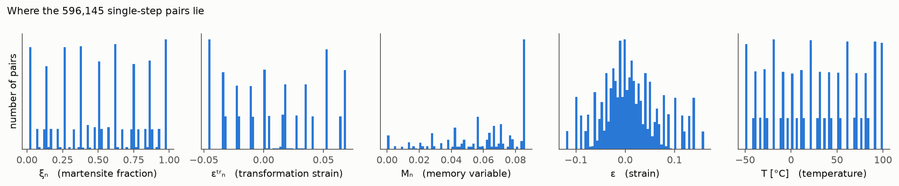
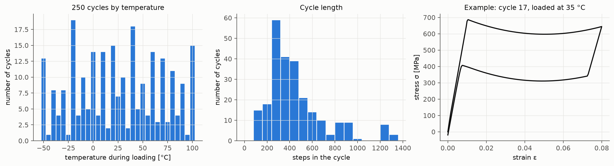

# Data

Everything here was computed by the reference solver of the constitutive model.
The solver itself is not part of this repository.

Column order in all files:

| | Columns |
|---|---|
| Inputs `X` | $\xi_n$, $\varepsilon^{\mathrm{tr}}_n$, $M_n$, $\varepsilon$, $T$ |
| Outputs `Y` | $\xi$, $\varepsilon^{\mathrm{tr}}$ |

$\varepsilon$ is the total strain and $T$ is in °C.

## Files

| File | Content | Size |
|---|---|---|
| `singlestep.npz` | 596,145 single solver steps. `X` (N, 5), `Y_delta` (N, 2) = output minus old state, `D` (N, 2) = $\partial/\partial\varepsilon$ of the outputs where available, zero otherwise | 11 MB |
| `cycles.npz` | 250 complete loading cycles, 111,890 steps in total, stored one after another. `X`, `Y`, `D` as above; `offsets`, `lengths` give the rows of each cycle; `cycle_ids`; `Tmean` | 1.4 MB |
| `bounds.npz` | smallest and largest value of each input in `singlestep.npz` | – |

Load them with [common/data.py](../common/data.py):

```python
from common.data import load_cycles, load_single_steps
cycles = load_cycles()          # list of 250 Cycle objects with .X, .Y
X, dY = load_single_steps()
```

## Where the rows come from

- **Single steps.** One solver call each, from a state and a load that are not part of a stored path. They were
  collected over several generations of sampling (states along simulated paths and states on grids), then
  merged and shuffled. The exact share of each generation was not recorded.
- **Cycles.** Complete simulations from $-50$ to $100\,^\circ$C: a start state, a programme of strain and
  temperature, and the solver's answer at every step. In a cycle the input state of step $t+1$ is the output
  of step $t$, and $M$ follows the rule of the constitutive model. The strain step is $5\cdot10^{-4}$.

## What the two sets look like

**Single steps.** The coverage of the five inputs is not even. Many rows sit on a few discrete values of
$\xi_n$, $\varepsilon^{\mathrm{tr}}_n$ and $T$ (grid samples), and the memory variable piles up at its upper limit.
In 14.2 % of the rows $\xi$ does not change, and in 4.7 % $\varepsilon^{\mathrm{tr}}$ does not change.

| Input | Meaning | Range in the data |
|---|---|---|
| $\xi_n$ | martensite fraction before the step | 0.015 to 0.985 |
| $\varepsilon^{\mathrm{tr}}_n$ | transformation strain before the step | $-0.046$ to $0.069$ |
| $M_n$ | memory variable before the step | 0 to 0.086 |
| $\varepsilon$ | strain at the end of the step | $-0.12$ to $0.16$ |
| $T$ | temperature at the end of the step | $-50$ to $100\,^\circ$C |



*Shown: for each of the five inputs, how many of the 596,145 single-step rows fall into each of 60 bins. Computed: a plain count of the rows of `singlestep.npz`.*

**Benchmark cycles.**



*Shown: left, how many of the 250 cycles are loaded at each temperature (5 °C bins); middle, how many cycles have each length (80-step bins); right, the stress–strain curve of one example cycle. Computed from `cycles.npz`; the stress is obtained from the solver's state with [common/stress.py](../common/stress.py).*

| Property of the cycles | Value |
|---|---|
| Temperature during loading | $-50$ to $100\,^\circ$C |
| Length | 80 to 1,320 steps, median 380 |
| Strain step | $5\cdot10^{-4}$ |
| Isothermal | 13 |
| Temperature ramp at fixed strain, then loading at constant temperature | 196 |
| Temperature changes during loading | 41 |
| Simple cycles (load once, unload once) | 134; the others contain partial loops |
| Steps in which $\xi$ does not change | 39.1 % |
| Steps in which $\varepsilon^{\mathrm{tr}}$ does not change | 59.8 % |

Along a real path the state stands still much more often than in the single-step set. On those steps the right
answer is exactly "no change".

## Splits

| Used for | Rows |
|---|---|
| Training the baseline network | the 596,145 single steps, plus the 78,810 consecutive steps of 176 cycles, all shuffled as individual pairs |
| Fine-tuning along the rollout | windows of consecutive steps from the same 176 cycles |
| Choosing the checkpoint | 37 validation cycles |
| Held out completely | 37 test cycles |

The split is by cycle, with a fixed seed (`common.data.split_cycles`). No row of the 74 validation and test
cycles is ever used for a gradient step.

## How the networks of Part I are scored on the cycles

- **One step.** The network gets the reference state at every step of every cycle. Reported as $R^2$ and as
  mean absolute error (MAE).
- **Free run.** The network gets the reference state of the first step only and then its own output. The MAE
  of $\xi$ is computed per cycle and averaged over the cycles.

The headline numbers are over all 250 cycles, as in the thesis. Because 176 of them contribute rows to
training, the results also list the 37 held-out cycles separately. "Cold" cycles are the 34 cycles loaded at
$-30\,^\circ$C or below, where the material is mostly martensite. A run counts as diverged if it produces a
non-finite number. Cycles in which $\xi$ deviates by more than 0.2 at any step are counted separately.

The numbers and figures of this page are produced by [describe_data.py](describe_data.py).

## Trained networks

The two networks of Part I are in [../models](../models): `v10` (step 01) and `v17` (step 02), each as ONNX
(input `[xi_n, etr_n, M_n, eps, T]`, output `[xi, etr]`) and as Keras weights for
[common/network.py](../common/network.py).
